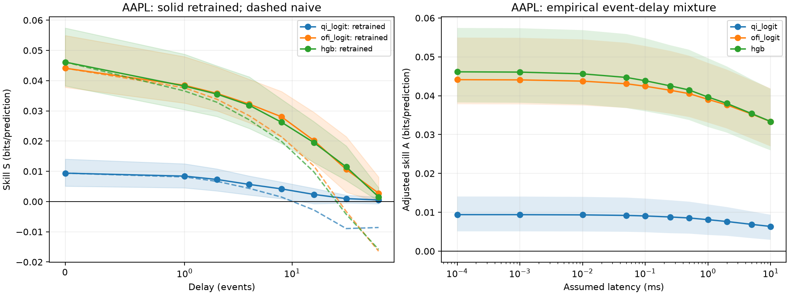
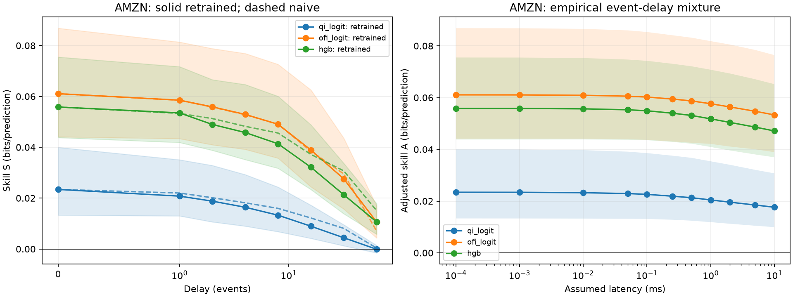
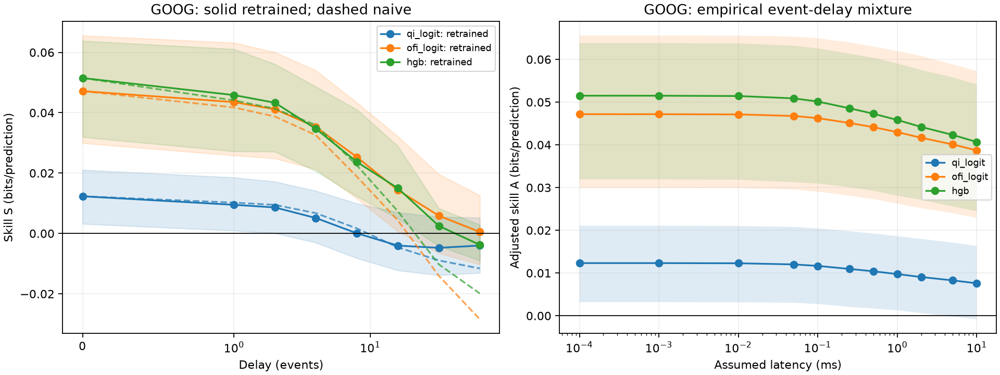
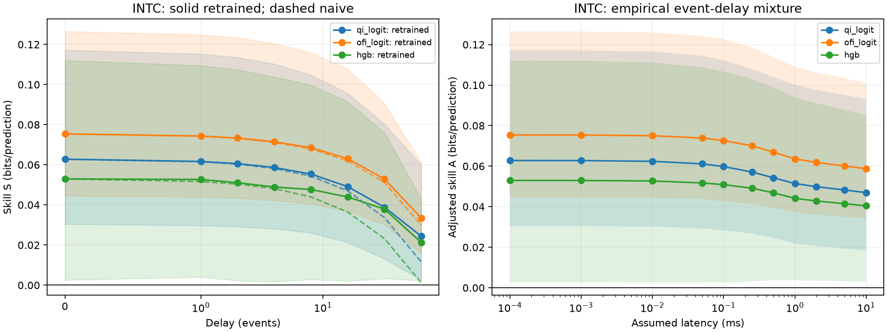
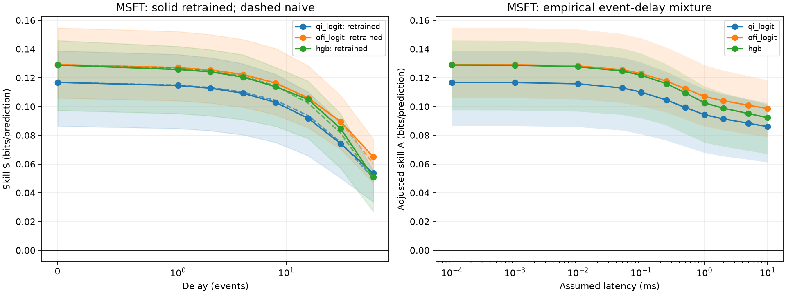

# Gate 0 results

**PASS**: 5 tickers have a paired interval excluding zero.

Execution hardware: Apple M5. Reference: i5-13600K / RTX 4060 Ti 8 GB (planned timing platform; no hardware timing here).

All skill values are bits/prediction; brackets are paired 95% percentile intervals.

| Ticker | Best on validation | A(100 ns) | A(2 ms) | Delta | Excludes zero |
|---|---|---:|---:|---:|---|
| AAPL | hgb | 0.046146 [0.038276, 0.057432] | 0.038015 [0.030506, 0.047542] | 0.008130 [0.006806, 0.010524] | True |
| AMZN | ofi_logit | 0.061067 [0.044114, 0.086846] | 0.056403 [0.041088, 0.080518] | 0.004663 [0.002066, 0.006939] | True |
| GOOG | hgb | 0.051506 [0.031927, 0.063828] | 0.044200 [0.027130, 0.057520] | 0.007306 [0.001994, 0.008576] | True |
| INTC | qi_logit | 0.062789 [0.030385, 0.117204] | 0.049874 [0.020690, 0.097672] | 0.012915 [0.008487, 0.020437] | True |
| MSFT | hgb | 0.128873 [0.097331, 0.145840] | 0.098797 [0.072058, 0.109360] | 0.030077 [0.023695, 0.037376] | True |

## AAPL

Hardware: Apple M5; reference: i5-13600K / RTX 4060 Ti 8 GB (planned timing platform; no hardware timing here).

| Split | Eligible anchors |
|---|---:|
| train | 203282 |
| validation | 58581 |
| test | 85792 |

### retrained

Hardware: Apple M5; reference: i5-13600K / RTX 4060 Ti 8 GB (planned timing platform; no hardware timing here).

| Model | Delay (events) | S [95% CI] | Accuracy | MCC | S(0)-S(tau) [95% CI] |
|---|---:|---:|---:|---:|---:|
| qi_logit | 0 | 0.009398 [0.005097, 0.014064] | 0.545587 | 0.086041 | 0.000000 [0.000000, 0.000000] |
| qi_logit | 1 | 0.008418 [0.004537, 0.012506] | 0.542218 | 0.078999 | 0.000980 [0.000247, 0.002084] |
| qi_logit | 2 | 0.007312 [0.003530, 0.010814] | 0.539234 | 0.072732 | 0.002086 [0.001054, 0.003739] |
| qi_logit | 4 | 0.005671 [0.002180, 0.008463] | 0.533022 | 0.059606 | 0.003727 [0.002021, 0.006413] |
| qi_logit | 8 | 0.004185 [0.000967, 0.006449] | 0.528441 | 0.048286 | 0.005213 [0.002702, 0.008756] |
| qi_logit | 16 | 0.002360 [-0.000704, 0.004364] | 0.522310 | 0.029965 | 0.007038 [0.003514, 0.011632] |
| qi_logit | 32 | 0.000972 [-0.000477, 0.002126] | 0.518417 | 0.016246 | 0.008426 [0.004326, 0.012752] |
| qi_logit | 64 | 0.000526 [-0.000726, 0.001501] | 0.517927 | 0.014008 | 0.008872 [0.004804, 0.013285] |
| ofi_logit | 0 | 0.044123 [0.037807, 0.054958] | 0.602410 | 0.202755 | 0.000000 [0.000000, 0.000000] |
| ofi_logit | 1 | 0.038469 [0.032579, 0.047926] | 0.597701 | 0.193236 | 0.005654 [0.004634, 0.007416] |
| ofi_logit | 2 | 0.035791 [0.030040, 0.044507] | 0.596757 | 0.191281 | 0.008332 [0.006850, 0.011050] |
| ofi_logit | 4 | 0.032256 [0.026089, 0.040437] | 0.591967 | 0.181628 | 0.011868 [0.009768, 0.015726] |
| ofi_logit | 8 | 0.028037 [0.021359, 0.036421] | 0.584647 | 0.166669 | 0.016086 [0.012753, 0.021294] |
| ofi_logit | 16 | 0.020191 [0.012683, 0.029533] | 0.574273 | 0.145122 | 0.023932 [0.018998, 0.030296] |
| ofi_logit | 32 | 0.010636 [0.003116, 0.021471] | 0.562966 | 0.121582 | 0.033487 [0.027191, 0.039732] |
| ofi_logit | 64 | 0.002758 [-0.000182, 0.008097] | 0.537148 | 0.066577 | 0.041365 [0.036165, 0.048303] |
| hgb | 0 | 0.046146 [0.038276, 0.057432] | 0.599781 | 0.198346 | 0.000000 [0.000000, 0.000000] |
| hgb | 1 | 0.038201 [0.030402, 0.048753] | 0.591358 | 0.180842 | 0.007945 [0.006686, 0.010004] |
| hgb | 2 | 0.035556 [0.028152, 0.044912] | 0.587423 | 0.172578 | 0.010589 [0.008632, 0.013794] |
| hgb | 4 | 0.031868 [0.024198, 0.041265] | 0.583185 | 0.163746 | 0.014278 [0.012007, 0.017858] |
| hgb | 8 | 0.026232 [0.019187, 0.033824] | 0.579352 | 0.155749 | 0.019914 [0.016547, 0.025267] |
| hgb | 16 | 0.019507 [0.012945, 0.026450] | 0.568543 | 0.133848 | 0.026639 [0.022514, 0.032322] |
| hgb | 32 | 0.011462 [0.006994, 0.018405] | 0.562770 | 0.121156 | 0.034684 [0.028369, 0.041107] |
| hgb | 64 | 0.001541 [0.000159, 0.004621] | 0.528616 | 0.050941 | 0.044604 [0.037386, 0.053382] |

### naive

Hardware: Apple M5; reference: i5-13600K / RTX 4060 Ti 8 GB (planned timing platform; no hardware timing here).

| Model | Delay (events) | S [95% CI] | Accuracy | MCC | S(0)-S(tau) [95% CI] |
|---|---:|---:|---:|---:|---:|
| qi_logit | 0 | 0.009398 [0.005097, 0.014064] | 0.545587 | 0.086041 | 0.000000 [0.000000, 0.000000] |
| qi_logit | 1 | 0.008151 [0.004130, 0.012394] | 0.541391 | 0.077435 | 0.001247 [0.000454, 0.002224] |
| qi_logit | 2 | 0.006691 [0.002601, 0.010656] | 0.537777 | 0.070024 | 0.002707 [0.001846, 0.004146] |
| qi_logit | 4 | 0.004363 [0.000337, 0.007802] | 0.532765 | 0.059744 | 0.005036 [0.003832, 0.007235] |
| qi_logit | 8 | 0.001477 [-0.002512, 0.004456] | 0.525865 | 0.045592 | 0.007921 [0.006247, 0.011121] |
| qi_logit | 16 | -0.002790 [-0.007286, 0.000587] | 0.515747 | 0.024841 | 0.012189 [0.010069, 0.016265] |
| qi_logit | 32 | -0.008938 [-0.013644, -0.004762] | 0.506586 | 0.006051 | 0.018336 [0.014652, 0.023548] |
| qi_logit | 64 | -0.008588 [-0.012773, -0.005065] | 0.508322 | 0.009629 | 0.017986 [0.014063, 0.023080] |
| ofi_logit | 0 | 0.044123 [0.037807, 0.054958] | 0.602410 | 0.202755 | 0.000000 [0.000000, 0.000000] |
| ofi_logit | 1 | 0.037646 [0.031600, 0.047712] | 0.595300 | 0.188467 | 0.006478 [0.005120, 0.007982] |
| ofi_logit | 2 | 0.033854 [0.027727, 0.043227] | 0.591430 | 0.180691 | 0.010270 [0.008516, 0.012745] |
| ofi_logit | 4 | 0.028401 [0.021497, 0.037716] | 0.583411 | 0.164577 | 0.015723 [0.013407, 0.019405] |
| ofi_logit | 8 | 0.021409 [0.013642, 0.031188] | 0.574016 | 0.145698 | 0.022714 [0.019074, 0.027807] |
| ofi_logit | 16 | 0.011750 [0.002991, 0.022417] | 0.559889 | 0.117311 | 0.032373 [0.028073, 0.038405] |
| ofi_logit | 32 | -0.003301 [-0.013206, 0.009116] | 0.541706 | 0.080772 | 0.047425 [0.040508, 0.054960] |
| ofi_logit | 64 | -0.016409 [-0.026864, -0.004014] | 0.526984 | 0.051196 | 0.060532 [0.051635, 0.069356] |
| hgb | 0 | 0.046146 [0.038276, 0.057432] | 0.599781 | 0.198346 | 0.000000 [0.000000, 0.000000] |
| hgb | 1 | 0.036584 [0.029367, 0.046727] | 0.589775 | 0.178302 | 0.009562 [0.008660, 0.011093] |
| hgb | 2 | 0.032858 [0.026160, 0.041838] | 0.584978 | 0.168691 | 0.013287 [0.011389, 0.016182] |
| hgb | 4 | 0.027042 [0.020016, 0.035863] | 0.576940 | 0.152589 | 0.019104 [0.016745, 0.023165] |
| hgb | 8 | 0.019890 [0.012126, 0.028806] | 0.566920 | 0.132517 | 0.026255 [0.023178, 0.031480] |
| hgb | 16 | 0.009800 [0.001765, 0.019659] | 0.551581 | 0.101788 | 0.036345 [0.031378, 0.042566] |
| hgb | 32 | -0.004218 [-0.013364, 0.006518] | 0.537500 | 0.073581 | 0.050364 [0.043909, 0.057790] |
| hgb | 64 | -0.015836 [-0.024502, -0.003633] | 0.524956 | 0.048455 | 0.061982 [0.052741, 0.070203] |

### Wall-clock conversion

Hardware: Apple M5; reference: i5-13600K / RTX 4060 Ti 8 GB (planned timing platform; no hardware timing here).

| L | P(tau>=1) | Mean tau | p50 | p90 | p99 | P(tau>64) |
|---|---:|---:|---:|---:|---:|---:|
| 100 ns | 0.000000 | 0.000000 | 0.00 | 0.00 | 0.00 | 0.000000 |
| 1 us | 0.009267 | 0.009290 | 0.00 | 0.00 | 0.00 | 0.000000 |
| 10 us | 0.064190 | 0.068724 | 0.00 | 0.00 | 1.00 | 0.000000 |
| 50 us | 0.171589 | 0.204203 | 0.00 | 1.00 | 2.00 | 0.000000 |
| 100 us | 0.265642 | 0.340148 | 0.00 | 1.00 | 3.00 | 0.000000 |
| 250 us | 0.386924 | 0.620955 | 0.00 | 2.00 | 4.00 | 0.000000 |
| 500 us | 0.463796 | 0.927732 | 0.00 | 3.00 | 7.00 | 0.000000 |
| 1 ms | 0.591850 | 1.495862 | 1.00 | 4.00 | 11.00 | 0.000000 |
| 2 ms | 0.655306 | 2.303991 | 1.00 | 6.00 | 16.00 | 0.000000 |
| 5 ms | 0.722049 | 4.105849 | 2.00 | 11.00 | 27.00 | 0.000734 |
| 10 ms | 0.762868 | 6.013090 | 3.00 | 16.00 | 41.00 | 0.002017 |

### latency_adjusted

Hardware: Apple M5; reference: i5-13600K / RTX 4060 Ti 8 GB (planned timing platform; no hardware timing here).

| Model | L | A [95% CI] | A(100 ns)-A(L) [95% CI] |
|---|---|---:|---:|
| qi_logit | 100 ns | 0.009398 [0.005097, 0.014064] | 0.000000 [0.000000, 0.000000] |
| qi_logit | 1 us | 0.009389 [0.005092, 0.014052] | 0.000009 [0.000002, 0.000018] |
| qi_logit | 10 us | 0.009331 [0.005058, 0.013965] | 0.000068 [0.000020, 0.000136] |
| qi_logit | 50 us | 0.009196 [0.004979, 0.013782] | 0.000203 [0.000065, 0.000404] |
| qi_logit | 100 us | 0.009061 [0.004874, 0.013536] | 0.000337 [0.000122, 0.000678] |
| qi_logit | 250 us | 0.008795 [0.004619, 0.013103] | 0.000603 [0.000244, 0.001189] |
| qi_logit | 500 us | 0.008539 [0.004513, 0.012735] | 0.000859 [0.000389, 0.001649] |
| qi_logit | 1 ms | 0.008104 [0.004166, 0.012039] | 0.001294 [0.000635, 0.002390] |
| qi_logit | 2 ms | 0.007632 [0.003946, 0.011345] | 0.001766 [0.000893, 0.003195] |
| qi_logit | 5 ms | 0.006889 [0.003333, 0.010218] | 0.002509 [0.001336, 0.004384] |
| qi_logit | 10 ms | 0.006361 [0.002919, 0.009368] | 0.003037 [0.001662, 0.005183] |
| ofi_logit | 100 ns | 0.044123 [0.037807, 0.054958] | 0.000000 [0.000000, 0.000000] |
| ofi_logit | 1 us | 0.044071 [0.037760, 0.054892] | 0.000052 [0.000042, 0.000068] |
| ofi_logit | 10 us | 0.043749 [0.037471, 0.054490] | 0.000375 [0.000302, 0.000482] |
| ofi_logit | 50 us | 0.043071 [0.036847, 0.053611] | 0.001052 [0.000861, 0.001367] |
| ofi_logit | 100 us | 0.042439 [0.036296, 0.052773] | 0.001685 [0.001360, 0.002222] |
| ofi_logit | 250 us | 0.041406 [0.035377, 0.051525] | 0.002717 [0.002198, 0.003691] |
| ofi_logit | 500 us | 0.040542 [0.034521, 0.050291] | 0.003581 [0.002912, 0.004883] |
| ofi_logit | 1 ms | 0.039059 [0.033075, 0.048445] | 0.005064 [0.004143, 0.006901] |
| ofi_logit | 2 ms | 0.037638 [0.031577, 0.046718] | 0.006485 [0.005337, 0.008842] |
| ofi_logit | 5 ms | 0.035268 [0.028941, 0.043950] | 0.008855 [0.007278, 0.011894] |
| ofi_logit | 10 ms | 0.033339 [0.026958, 0.041888] | 0.010785 [0.008932, 0.014317] |
| hgb | 100 ns | 0.046146 [0.038276, 0.057432] | 0.000000 [0.000000, 0.000000] |
| hgb | 1 us | 0.046072 [0.038195, 0.057364] | 0.000074 [0.000060, 0.000093] |
| hgb | 10 us | 0.045624 [0.037735, 0.056879] | 0.000522 [0.000431, 0.000652] |
| hgb | 50 us | 0.044700 [0.036812, 0.055865] | 0.001445 [0.001216, 0.001803] |
| hgb | 100 us | 0.043853 [0.035981, 0.054768] | 0.002293 [0.001933, 0.002897] |
| hgb | 250 us | 0.042536 [0.034828, 0.052997] | 0.003610 [0.003048, 0.004617] |
| hgb | 500 us | 0.041474 [0.033743, 0.051834] | 0.004671 [0.003959, 0.006004] |
| hgb | 1 ms | 0.039659 [0.031956, 0.049651] | 0.006486 [0.005494, 0.008360] |
| hgb | 2 ms | 0.038015 [0.030506, 0.047542] | 0.008130 [0.006806, 0.010524] |
| hgb | 5 ms | 0.035387 [0.027829, 0.044160] | 0.010758 [0.009219, 0.013857] |
| hgb | 10 ms | 0.033361 [0.025931, 0.041761] | 0.012784 [0.010897, 0.016362] |

### naive_latency_adjusted

Hardware: Apple M5; reference: i5-13600K / RTX 4060 Ti 8 GB (planned timing platform; no hardware timing here).

| Model | L | A [95% CI] | A(100 ns)-A(L) [95% CI] |
|---|---|---:|---:|
| qi_logit | 100 ns | 0.009398 [0.005097, 0.014064] | 0.000000 [0.000000, 0.000000] |
| qi_logit | 1 us | 0.009387 [0.005089, 0.014049] | 0.000012 [0.000004, 0.000020] |
| qi_logit | 10 us | 0.009312 [0.005034, 0.013953] | 0.000087 [0.000037, 0.000149] |
| qi_logit | 50 us | 0.009138 [0.004904, 0.013746] | 0.000260 [0.000122, 0.000442] |
| qi_logit | 100 us | 0.008964 [0.004699, 0.013507] | 0.000434 [0.000218, 0.000743] |
| qi_logit | 250 us | 0.008610 [0.004392, 0.013012] | 0.000788 [0.000461, 0.001324] |
| qi_logit | 500 us | 0.008254 [0.004067, 0.012602] | 0.001145 [0.000746, 0.001875] |
| qi_logit | 1 ms | 0.007634 [0.003456, 0.011825] | 0.001765 [0.001222, 0.002814] |
| qi_logit | 2 ms | 0.006895 [0.002727, 0.010868] | 0.002503 [0.001843, 0.003869] |
| qi_logit | 5 ms | 0.005594 [0.001431, 0.009373] | 0.003805 [0.003040, 0.005587] |
| qi_logit | 10 ms | 0.004537 [0.000437, 0.008077] | 0.004861 [0.003979, 0.006991] |
| ofi_logit | 100 ns | 0.044123 [0.037807, 0.054958] | 0.000000 [0.000000, 0.000000] |
| ofi_logit | 1 us | 0.044063 [0.037754, 0.054886] | 0.000060 [0.000047, 0.000072] |
| ofi_logit | 10 us | 0.043691 [0.037408, 0.054448] | 0.000432 [0.000342, 0.000520] |
| ofi_logit | 50 us | 0.042894 [0.036683, 0.053475] | 0.001229 [0.000986, 0.001502] |
| ofi_logit | 100 us | 0.042140 [0.035985, 0.052625] | 0.001983 [0.001564, 0.002481] |
| ofi_logit | 250 us | 0.040847 [0.034713, 0.051015] | 0.003276 [0.002596, 0.004170] |
| ofi_logit | 500 us | 0.039709 [0.033590, 0.049658] | 0.004414 [0.003562, 0.005651] |
| ofi_logit | 1 ms | 0.037752 [0.031512, 0.047344] | 0.006371 [0.005310, 0.008169] |
| ofi_logit | 2 ms | 0.035745 [0.029325, 0.045100] | 0.008378 [0.007140, 0.010758] |
| ofi_logit | 5 ms | 0.032373 [0.025441, 0.041494] | 0.011750 [0.010278, 0.014929] |
| ofi_logit | 10 ms | 0.029627 [0.022368, 0.038622] | 0.014497 [0.012714, 0.018222] |
| hgb | 100 ns | 0.046146 [0.038276, 0.057432] | 0.000000 [0.000000, 0.000000] |
| hgb | 1 us | 0.046057 [0.038186, 0.057341] | 0.000089 [0.000078, 0.000101] |
| hgb | 10 us | 0.045515 [0.037655, 0.056747] | 0.000630 [0.000561, 0.000720] |
| hgb | 50 us | 0.044388 [0.036603, 0.055433] | 0.001758 [0.001557, 0.002061] |
| hgb | 100 us | 0.043344 [0.035642, 0.054272] | 0.002802 [0.002435, 0.003360] |
| hgb | 250 us | 0.041671 [0.034088, 0.052095] | 0.004474 [0.003885, 0.005519] |
| hgb | 500 us | 0.040282 [0.032878, 0.050452] | 0.005864 [0.005153, 0.007277] |
| hgb | 1 ms | 0.037904 [0.030597, 0.047616] | 0.008242 [0.007328, 0.010189] |
| hgb | 2 ms | 0.035657 [0.028274, 0.044914] | 0.010489 [0.009358, 0.013014] |
| hgb | 5 ms | 0.032005 [0.024275, 0.040822] | 0.014140 [0.012727, 0.017399] |
| hgb | 10 ms | 0.029112 [0.021246, 0.037775] | 0.017034 [0.015317, 0.020830] |

### Direct checks (same retained test anchors for the paired comparison)

Hardware: Apple M5; reference: i5-13600K / RTX 4060 Ti 8 GB (planned timing platform; no hardware timing here).

| L (ns) | Direct S [95% CI] | Paired A [95% CI] | Direct - A [95% CI] | Dropped train/val/test |
|---:|---:|---:|---:|---|
| 10000 | 0.043917 [0.038029, 0.054763] | 0.043749 [0.037471, 0.054490] | 0.000168 [-0.000129, 0.000730] | 0.000000/0.000000/0.000000 |
| 1000000 | 0.040168 [0.033881, 0.049929] | 0.039059 [0.033075, 0.048445] | 0.001109 [-0.000779, 0.002976] | 0.000000/0.000000/0.000000 |

### OFI burst split

Hardware: Apple M5; reference: i5-13600K / RTX 4060 Ti 8 GB (planned timing platform; no hardware timing here).

| Group | Anchors | Delay (events) | S [95% CI] |
|---|---:|---:|---:|
| tau_1ms_zero | 35016 | 0 | 0.028652 [0.024443, 0.036969] |
| tau_1ms_zero | 35016 | 1 | 0.027577 [0.023779, 0.034383] |
| tau_1ms_zero | 35016 | 2 | 0.025276 [0.021752, 0.031481] |
| tau_1ms_zero | 35016 | 4 | 0.023183 [0.019648, 0.028974] |
| tau_1ms_zero | 35016 | 8 | 0.018163 [0.013405, 0.023525] |
| tau_1ms_zero | 35016 | 16 | 0.013862 [0.008302, 0.019935] |
| tau_1ms_zero | 35016 | 32 | 0.006695 [0.002642, 0.014889] |
| tau_1ms_zero | 35016 | 64 | 0.002776 [0.001224, 0.007307] |
| tau_1ms_at_least_one | 50776 | 0 | 0.054792 [0.044572, 0.068207] |
| tau_1ms_at_least_one | 50776 | 1 | 0.045981 [0.037002, 0.057971] |
| tau_1ms_at_least_one | 50776 | 2 | 0.043042 [0.034508, 0.054072] |
| tau_1ms_at_least_one | 50776 | 4 | 0.038512 [0.030039, 0.048544] |
| tau_1ms_at_least_one | 50776 | 8 | 0.034846 [0.025926, 0.045398] |
| tau_1ms_at_least_one | 50776 | 16 | 0.024556 [0.015518, 0.036164] |
| tau_1ms_at_least_one | 50776 | 32 | 0.013354 [0.002642, 0.026032] |
| tau_1ms_at_least_one | 50776 | 64 | 0.002746 [-0.001967, 0.009381] |

### HGB seed spread

Hardware: Apple M5; reference: i5-13600K / RTX 4060 Ti 8 GB (planned timing platform; no hardware timing here).

| Delay (events) | S min | S max | S std |
|---:|---:|---:|---:|
| 0 | 0.044904017 | 0.047103203 | 0.000942747 |
| 1 | 0.037501894 | 0.038772856 | 0.000466871 |
| 2 | 0.034697862 | 0.036381674 | 0.000544693 |
| 4 | 0.031487863 | 0.032330024 | 0.000278538 |
| 8 | 0.025524186 | 0.026631907 | 0.000414222 |
| 16 | 0.018652061 | 0.020755911 | 0.000692980 |
| 32 | 0.010855437 | 0.011924769 | 0.000403671 |
| 64 | 0.001297478 | 0.001762614 | 0.000193099 |

## AMZN

Hardware: Apple M5; reference: i5-13600K / RTX 4060 Ti 8 GB (planned timing platform; no hardware timing here).

| Split | Eligible anchors |
|---|---:|
| train | 143626 |
| validation | 42258 |
| test | 56898 |

### retrained

Hardware: Apple M5; reference: i5-13600K / RTX 4060 Ti 8 GB (planned timing platform; no hardware timing here).

| Model | Delay (events) | S [95% CI] | Accuracy | MCC | S(0)-S(tau) [95% CI] |
|---|---:|---:|---:|---:|---:|
| qi_logit | 0 | 0.023420 [0.013300, 0.039980] | 0.591040 | 0.180709 | 0.000000 [0.000000, 0.000000] |
| qi_logit | 1 | 0.020788 [0.013017, 0.035109] | 0.588615 | 0.175769 | 0.002632 [-0.000152, 0.005310] |
| qi_logit | 2 | 0.018809 [0.010649, 0.032868] | 0.583448 | 0.165255 | 0.004611 [0.002430, 0.007361] |
| qi_logit | 4 | 0.016410 [0.008991, 0.029265] | 0.575398 | 0.149222 | 0.007011 [0.003921, 0.011115] |
| qi_logit | 8 | 0.013283 [0.006817, 0.024352] | 0.572955 | 0.145339 | 0.010138 [0.005864, 0.016213] |
| qi_logit | 16 | 0.008951 [0.004176, 0.017229] | 0.562674 | 0.125212 | 0.014469 [0.008706, 0.023521] |
| qi_logit | 32 | 0.004417 [0.001255, 0.009539] | 0.546715 | 0.093086 | 0.019004 [0.011651, 0.031215] |
| qi_logit | 64 | -0.000108 [-0.001522, 0.001427] | 0.517083 | 0.046466 | 0.023529 [0.014501, 0.039394] |
| ofi_logit | 0 | 0.061067 [0.044114, 0.086846] | 0.615804 | 0.231487 | 0.000000 [0.000000, 0.000000] |
| ofi_logit | 1 | 0.058523 [0.043408, 0.081396] | 0.616929 | 0.233979 | 0.002543 [-0.000631, 0.005691] |
| ofi_logit | 2 | 0.055891 [0.040979, 0.078832] | 0.614257 | 0.228602 | 0.005176 [0.001922, 0.008534] |
| ofi_logit | 4 | 0.052927 [0.039188, 0.076898] | 0.612728 | 0.225838 | 0.008140 [0.003235, 0.012466] |
| ofi_logit | 8 | 0.049047 [0.035719, 0.072626] | 0.609160 | 0.219611 | 0.012020 [0.005494, 0.017953] |
| ofi_logit | 16 | 0.038912 [0.024427, 0.062550] | 0.604046 | 0.212170 | 0.022155 [0.014917, 0.030777] |
| ofi_logit | 32 | 0.027585 [0.015710, 0.043582] | 0.586101 | 0.179704 | 0.033482 [0.025673, 0.047197] |
| ofi_logit | 64 | 0.010606 [0.004318, 0.016971] | 0.547981 | 0.119418 | 0.050461 [0.037083, 0.072467] |
| hgb | 0 | 0.055833 [0.043813, 0.075500] | 0.614257 | 0.230131 | 0.000000 [0.000000, 0.000000] |
| hgb | 1 | 0.053521 [0.041894, 0.071725] | 0.610285 | 0.221445 | 0.002312 [0.000459, 0.005383] |
| hgb | 2 | 0.048968 [0.038799, 0.066586] | 0.606542 | 0.213509 | 0.006865 [0.002985, 0.011126] |
| hgb | 4 | 0.045800 [0.035150, 0.064691] | 0.605839 | 0.211645 | 0.010033 [0.005183, 0.014619] |
| hgb | 8 | 0.041373 [0.031742, 0.060059] | 0.606559 | 0.213504 | 0.014460 [0.008682, 0.019605] |
| hgb | 16 | 0.032142 [0.023372, 0.048837] | 0.600267 | 0.201257 | 0.023691 [0.017454, 0.030892] |
| hgb | 32 | 0.021330 [0.013854, 0.033705] | 0.589581 | 0.178664 | 0.034503 [0.027713, 0.045008] |
| hgb | 64 | 0.010626 [0.005791, 0.017870] | 0.564976 | 0.129084 | 0.045207 [0.036434, 0.059583] |

### naive

Hardware: Apple M5; reference: i5-13600K / RTX 4060 Ti 8 GB (planned timing platform; no hardware timing here).

| Model | Delay (events) | S [95% CI] | Accuracy | MCC | S(0)-S(tau) [95% CI] |
|---|---:|---:|---:|---:|---:|
| qi_logit | 0 | 0.023420 [0.013300, 0.039980] | 0.591040 | 0.180709 | 0.000000 [0.000000, 0.000000] |
| qi_logit | 1 | 0.022006 [0.013293, 0.038022] | 0.588773 | 0.176069 | 0.001415 [-0.000872, 0.003112] |
| qi_logit | 2 | 0.020154 [0.010676, 0.036610] | 0.583799 | 0.165898 | 0.003267 [0.001792, 0.004579] |
| qi_logit | 4 | 0.018167 [0.009124, 0.033906] | 0.578808 | 0.155697 | 0.005254 [0.003137, 0.007486] |
| qi_logit | 8 | 0.015963 [0.007211, 0.031218] | 0.573851 | 0.145569 | 0.007458 [0.004430, 0.010775] |
| qi_logit | 16 | 0.012193 [0.004318, 0.026221] | 0.562498 | 0.122381 | 0.011228 [0.006476, 0.016025] |
| qi_logit | 32 | 0.008106 [0.000049, 0.021840] | 0.554642 | 0.106363 | 0.015314 [0.009203, 0.021647] |
| qi_logit | 64 | 0.000360 [-0.009017, 0.011491] | 0.541864 | 0.080172 | 0.023060 [0.015962, 0.034180] |
| ofi_logit | 0 | 0.061067 [0.044114, 0.086846] | 0.615804 | 0.231487 | 0.000000 [0.000000, 0.000000] |
| ofi_logit | 1 | 0.058490 [0.042319, 0.083311] | 0.614943 | 0.229717 | 0.002576 [0.000189, 0.004271] |
| ofi_logit | 2 | 0.055782 [0.039674, 0.081004] | 0.611023 | 0.221688 | 0.005284 [0.002711, 0.006929] |
| ofi_logit | 4 | 0.052804 [0.036867, 0.079531] | 0.607297 | 0.214062 | 0.008263 [0.003657, 0.011011] |
| ofi_logit | 8 | 0.049044 [0.032648, 0.076675] | 0.603396 | 0.206076 | 0.012023 [0.005009, 0.016796] |
| ofi_logit | 16 | 0.038477 [0.019899, 0.069733] | 0.594819 | 0.188536 | 0.022590 [0.013458, 0.029970] |
| ofi_logit | 32 | 0.029519 [0.011092, 0.055272] | 0.590513 | 0.179760 | 0.031548 [0.023386, 0.041851] |
| ofi_logit | 64 | 0.007065 [-0.010216, 0.024108] | 0.574924 | 0.147771 | 0.054002 [0.037312, 0.082986] |
| hgb | 0 | 0.055833 [0.043813, 0.075500] | 0.614257 | 0.230131 | 0.000000 [0.000000, 0.000000] |
| hgb | 1 | 0.053319 [0.041419, 0.072774] | 0.613572 | 0.228698 | 0.002514 [0.000344, 0.004519] |
| hgb | 2 | 0.051286 [0.039490, 0.071247] | 0.610144 | 0.221572 | 0.004547 [0.002441, 0.006105] |
| hgb | 4 | 0.048242 [0.036340, 0.069136] | 0.607227 | 0.215514 | 0.007591 [0.004276, 0.009845] |
| hgb | 8 | 0.045591 [0.032988, 0.068056] | 0.605083 | 0.211061 | 0.010242 [0.005261, 0.013854] |
| hgb | 16 | 0.037191 [0.023647, 0.062316] | 0.595170 | 0.190497 | 0.018641 [0.010164, 0.025114] |
| hgb | 32 | 0.030732 [0.015064, 0.055151] | 0.588650 | 0.177005 | 0.025101 [0.016905, 0.034174] |
| hgb | 64 | 0.015101 [-0.003840, 0.035472] | 0.570038 | 0.138251 | 0.040732 [0.031792, 0.054117] |

### Wall-clock conversion

Hardware: Apple M5; reference: i5-13600K / RTX 4060 Ti 8 GB (planned timing platform; no hardware timing here).

| L | P(tau>=1) | Mean tau | p50 | p90 | p99 | P(tau>64) |
|---|---:|---:|---:|---:|---:|---:|
| 100 ns | 0.000000 | 0.000000 | 0.00 | 0.00 | 0.00 | 0.000000 |
| 1 us | 0.007997 | 0.007997 | 0.00 | 0.00 | 0.00 | 0.000000 |
| 10 us | 0.061443 | 0.067542 | 0.00 | 0.00 | 1.00 | 0.000000 |
| 50 us | 0.164189 | 0.202485 | 0.00 | 1.00 | 2.00 | 0.000000 |
| 100 us | 0.249482 | 0.339080 | 0.00 | 1.00 | 3.00 | 0.000000 |
| 250 us | 0.400295 | 0.697406 | 0.00 | 2.00 | 5.00 | 0.000000 |
| 500 us | 0.477802 | 1.089704 | 0.00 | 3.00 | 9.00 | 0.000000 |
| 1 ms | 0.575714 | 1.783666 | 1.00 | 5.00 | 13.00 | 0.000000 |
| 2 ms | 0.632184 | 2.788921 | 1.00 | 7.00 | 20.00 | 0.004060 |
| 5 ms | 0.690727 | 4.554800 | 2.00 | 11.00 | 31.00 | 0.006239 |
| 10 ms | 0.728866 | 6.036152 | 2.00 | 15.00 | 41.03 | 0.006433 |

### latency_adjusted

Hardware: Apple M5; reference: i5-13600K / RTX 4060 Ti 8 GB (planned timing platform; no hardware timing here).

| Model | L | A [95% CI] | A(100 ns)-A(L) [95% CI] |
|---|---|---:|---:|
| qi_logit | 100 ns | 0.023420 [0.013300, 0.039980] | 0.000000 [0.000000, 0.000000] |
| qi_logit | 1 us | 0.023399 [0.013292, 0.039944] | 0.000021 [-0.000001, 0.000042] |
| qi_logit | 10 us | 0.023247 [0.013253, 0.039696] | 0.000174 [0.000009, 0.000330] |
| qi_logit | 50 us | 0.022917 [0.013193, 0.039106] | 0.000504 [0.000076, 0.000920] |
| qi_logit | 100 us | 0.022605 [0.013104, 0.038556] | 0.000815 [0.000174, 0.001466] |
| qi_logit | 250 us | 0.021902 [0.012799, 0.037560] | 0.001518 [0.000504, 0.002598] |
| qi_logit | 500 us | 0.021318 [0.012441, 0.036723] | 0.002102 [0.000844, 0.003479] |
| qi_logit | 1 ms | 0.020455 [0.011870, 0.035386] | 0.002965 [0.001396, 0.004790] |
| qi_logit | 2 ms | 0.019593 [0.011251, 0.034042] | 0.003828 [0.001948, 0.006164] |
| qi_logit | 5 ms | 0.018487 [0.010489, 0.032081] | 0.004933 [0.002645, 0.007957] |
| qi_logit | 10 ms | 0.017638 [0.009940, 0.030734] | 0.005783 [0.003110, 0.009447] |
| ofi_logit | 100 ns | 0.061067 [0.044114, 0.086846] | 0.000000 [0.000000, 0.000000] |
| ofi_logit | 1 us | 0.061046 [0.044110, 0.086811] | 0.000020 [-0.000005, 0.000044] |
| ofi_logit | 10 us | 0.060894 [0.044075, 0.086564] | 0.000172 [-0.000023, 0.000349] |
| ofi_logit | 50 us | 0.060554 [0.043898, 0.085985] | 0.000512 [-0.000015, 0.001000] |
| ofi_logit | 100 us | 0.060223 [0.043688, 0.085354] | 0.000843 [0.000038, 0.001608] |
| ofi_logit | 250 us | 0.059444 [0.043049, 0.084109] | 0.001623 [0.000270, 0.002877] |
| ofi_logit | 500 us | 0.058727 [0.042557, 0.083165] | 0.002340 [0.000626, 0.003844] |
| ofi_logit | 1 ms | 0.057638 [0.042119, 0.081830] | 0.003428 [0.001238, 0.005296] |
| ofi_logit | 2 ms | 0.056403 [0.041088, 0.080518] | 0.004663 [0.002066, 0.006939] |
| ofi_logit | 5 ms | 0.054723 [0.040031, 0.078420] | 0.006344 [0.003313, 0.009139] |
| ofi_logit | 10 ms | 0.053319 [0.038926, 0.076443] | 0.007748 [0.004333, 0.011046] |
| hgb | 100 ns | 0.055833 [0.043813, 0.075500] | 0.000000 [0.000000, 0.000000] |
| hgb | 1 us | 0.055814 [0.043819, 0.075477] | 0.000018 [0.000004, 0.000044] |
| hgb | 10 us | 0.055663 [0.043836, 0.075297] | 0.000170 [0.000045, 0.000365] |
| hgb | 50 us | 0.055294 [0.043712, 0.074703] | 0.000539 [0.000189, 0.001048] |
| hgb | 100 us | 0.054918 [0.043544, 0.074214] | 0.000915 [0.000359, 0.001698] |
| hgb | 250 us | 0.053980 [0.042891, 0.073080] | 0.001853 [0.000834, 0.003152] |
| hgb | 500 us | 0.053104 [0.042187, 0.072107] | 0.002729 [0.001346, 0.004327] |
| hgb | 1 ms | 0.051793 [0.040922, 0.070771] | 0.004040 [0.002244, 0.006007] |
| hgb | 2 ms | 0.050425 [0.039585, 0.069329] | 0.005408 [0.003225, 0.007602] |
| hgb | 5 ms | 0.048598 [0.038035, 0.067103] | 0.007235 [0.004523, 0.009920] |
| hgb | 10 ms | 0.047124 [0.036942, 0.065206] | 0.008709 [0.005610, 0.011757] |

### naive_latency_adjusted

Hardware: Apple M5; reference: i5-13600K / RTX 4060 Ti 8 GB (planned timing platform; no hardware timing here).

| Model | L | A [95% CI] | A(100 ns)-A(L) [95% CI] |
|---|---|---:|---:|
| qi_logit | 100 ns | 0.023420 [0.013300, 0.039980] | 0.000000 [0.000000, 0.000000] |
| qi_logit | 1 us | 0.023409 [0.013292, 0.039970] | 0.000011 [-0.000007, 0.000023] |
| qi_logit | 10 us | 0.023322 [0.013289, 0.039894] | 0.000098 [-0.000036, 0.000189] |
| qi_logit | 50 us | 0.023122 [0.013287, 0.039666] | 0.000299 [-0.000043, 0.000545] |
| qi_logit | 100 us | 0.022922 [0.013245, 0.039430] | 0.000498 [0.000003, 0.000883] |
| qi_logit | 250 us | 0.022439 [0.012836, 0.038913] | 0.000981 [0.000185, 0.001600] |
| qi_logit | 500 us | 0.022001 [0.012405, 0.038464] | 0.001419 [0.000459, 0.002170] |
| qi_logit | 1 ms | 0.021348 [0.011793, 0.037742] | 0.002073 [0.000941, 0.003027] |
| qi_logit | 2 ms | 0.020659 [0.011081, 0.036923] | 0.002761 [0.001459, 0.003928] |
| qi_logit | 5 ms | 0.019786 [0.010439, 0.035723] | 0.003635 [0.002057, 0.005065] |
| qi_logit | 10 ms | 0.019099 [0.009971, 0.034786] | 0.004322 [0.002522, 0.005962] |
| ofi_logit | 100 ns | 0.061067 [0.044114, 0.086846] | 0.000000 [0.000000, 0.000000] |
| ofi_logit | 1 us | 0.061046 [0.044105, 0.086825] | 0.000021 [0.000002, 0.000032] |
| ofi_logit | 10 us | 0.060892 [0.044021, 0.086673] | 0.000175 [0.000028, 0.000263] |
| ofi_logit | 50 us | 0.060546 [0.043652, 0.086326] | 0.000520 [0.000127, 0.000768] |
| ofi_logit | 100 us | 0.060210 [0.043308, 0.085887] | 0.000856 [0.000255, 0.001225] |
| ofi_logit | 250 us | 0.059419 [0.042368, 0.084788] | 0.001648 [0.000635, 0.002266] |
| ofi_logit | 500 us | 0.058691 [0.042035, 0.084247] | 0.002375 [0.001080, 0.003135] |
| ofi_logit | 1 ms | 0.057604 [0.041115, 0.083410] | 0.003462 [0.001673, 0.004453] |
| ofi_logit | 2 ms | 0.056336 [0.039930, 0.082326] | 0.004731 [0.002428, 0.006006] |
| ofi_logit | 5 ms | 0.054655 [0.038462, 0.081025] | 0.006412 [0.003561, 0.008126] |
| ofi_logit | 10 ms | 0.053266 [0.037216, 0.079666] | 0.007801 [0.004634, 0.009847] |
| hgb | 100 ns | 0.055833 [0.043813, 0.075500] | 0.000000 [0.000000, 0.000000] |
| hgb | 1 us | 0.055813 [0.043807, 0.075481] | 0.000020 [0.000003, 0.000035] |
| hgb | 10 us | 0.055666 [0.043750, 0.075351] | 0.000167 [0.000035, 0.000278] |
| hgb | 50 us | 0.055345 [0.043583, 0.075070] | 0.000488 [0.000140, 0.000768] |
| hgb | 100 us | 0.055036 [0.043387, 0.074802] | 0.000797 [0.000279, 0.001220] |
| hgb | 250 us | 0.054326 [0.042782, 0.074195] | 0.001507 [0.000674, 0.002193] |
| hgb | 500 us | 0.053689 [0.042100, 0.073582] | 0.002143 [0.001129, 0.002880] |
| hgb | 1 ms | 0.052754 [0.041082, 0.072608] | 0.003079 [0.001735, 0.004036] |
| hgb | 2 ms | 0.051706 [0.039919, 0.071801] | 0.004127 [0.002500, 0.005182] |
| hgb | 5 ms | 0.050329 [0.038299, 0.070670] | 0.005504 [0.003452, 0.006767] |
| hgb | 10 ms | 0.049212 [0.037043, 0.069740] | 0.006621 [0.004244, 0.008143] |

### Direct checks (same retained test anchors for the paired comparison)

Hardware: Apple M5; reference: i5-13600K / RTX 4060 Ti 8 GB (planned timing platform; no hardware timing here).

| L (ns) | Direct S [95% CI] | Paired A [95% CI] | Direct - A [95% CI] | Dropped train/val/test |
|---:|---:|---:|---:|---|
| 10000 | 0.061050 [0.044012, 0.086863] | 0.060894 [0.044075, 0.086564] | 0.000156 [-0.000103, 0.000429] | 0.000000/0.000000/0.000000 |
| 1000000 | 0.056361 [0.039339, 0.080842] | 0.057638 [0.042119, 0.081830] | -0.001278 [-0.004208, 0.001362] | 0.000000/0.000000/0.000000 |

### OFI burst split

Hardware: Apple M5; reference: i5-13600K / RTX 4060 Ti 8 GB (planned timing platform; no hardware timing here).

| Group | Anchors | Delay (events) | S [95% CI] |
|---|---:|---:|---:|
| tau_1ms_zero | 24141 | 0 | 0.040883 [0.027115, 0.064193] |
| tau_1ms_zero | 24141 | 1 | 0.038093 [0.026216, 0.059102] |
| tau_1ms_zero | 24141 | 2 | 0.036660 [0.025523, 0.057624] |
| tau_1ms_zero | 24141 | 4 | 0.035785 [0.024609, 0.057015] |
| tau_1ms_zero | 24141 | 8 | 0.032267 [0.021762, 0.051650] |
| tau_1ms_zero | 24141 | 16 | 0.026133 [0.014408, 0.043342] |
| tau_1ms_zero | 24141 | 32 | 0.014791 [0.005801, 0.024482] |
| tau_1ms_zero | 24141 | 64 | 0.003978 [-0.002008, 0.009646] |
| tau_1ms_at_least_one | 32757 | 0 | 0.075942 [0.053168, 0.104956] |
| tau_1ms_at_least_one | 32757 | 1 | 0.073580 [0.055847, 0.098825] |
| tau_1ms_at_least_one | 32757 | 2 | 0.070063 [0.050087, 0.096189] |
| tau_1ms_at_least_one | 32757 | 4 | 0.065560 [0.047494, 0.092370] |
| tau_1ms_at_least_one | 32757 | 8 | 0.061413 [0.044070, 0.088967] |
| tau_1ms_at_least_one | 32757 | 16 | 0.048329 [0.030549, 0.077422] |
| tau_1ms_at_least_one | 32757 | 32 | 0.037013 [0.022145, 0.057957] |
| tau_1ms_at_least_one | 32757 | 64 | 0.015490 [0.008658, 0.022843] |

### HGB seed spread

Hardware: Apple M5; reference: i5-13600K / RTX 4060 Ti 8 GB (planned timing platform; no hardware timing here).

| Delay (events) | S min | S max | S std |
|---:|---:|---:|---:|
| 0 | 0.055832886 | 0.055832886 | 0.000000000 |
| 1 | 0.053520632 | 0.053520632 | 0.000000000 |
| 2 | 0.048967658 | 0.048967658 | 0.000000000 |
| 4 | 0.045799785 | 0.045799785 | 0.000000000 |
| 8 | 0.041372829 | 0.041372829 | 0.000000000 |
| 16 | 0.032142192 | 0.032142192 | 0.000000000 |
| 32 | 0.021329591 | 0.021329591 | 0.000000000 |
| 64 | 0.010625632 | 0.010625632 | 0.000000000 |

## GOOG

Hardware: Apple M5; reference: i5-13600K / RTX 4060 Ti 8 GB (planned timing platform; no hardware timing here).

| Split | Eligible anchors |
|---|---:|
| train | 76910 |
| validation | 22946 |
| test | 26298 |

### retrained

Hardware: Apple M5; reference: i5-13600K / RTX 4060 Ti 8 GB (planned timing platform; no hardware timing here).

| Model | Delay (events) | S [95% CI] | Accuracy | MCC | S(0)-S(tau) [95% CI] |
|---|---:|---:|---:|---:|---:|
| qi_logit | 0 | 0.012322 [0.003183, 0.021061] | 0.558940 | 0.109621 | 0.000000 [0.000000, 0.000000] |
| qi_logit | 1 | 0.009498 [0.000932, 0.018545] | 0.550878 | 0.092007 | 0.002824 [0.000518, 0.004356] |
| qi_logit | 2 | 0.008629 [0.000109, 0.017172] | 0.545213 | 0.079153 | 0.003693 [0.000982, 0.005793] |
| qi_logit | 4 | 0.005120 [-0.003037, 0.014102] | 0.537379 | 0.060992 | 0.007202 [0.003389, 0.009922] |
| qi_logit | 8 | 0.000067 [-0.008193, 0.009942] | 0.525211 | 0.029584 | 0.012255 [0.006044, 0.016766] |
| qi_logit | 16 | -0.004021 [-0.012247, 0.006975] | 0.523272 | 0.019639 | 0.016343 [0.008413, 0.022162] |
| qi_logit | 32 | -0.004766 [-0.013836, 0.005530] | 0.520990 | -0.018005 | 0.017088 [0.007274, 0.025074] |
| qi_logit | 64 | -0.003996 [-0.013030, 0.005209] | 0.520952 | -0.016306 | 0.016318 [0.006285, 0.025242] |
| ofi_logit | 0 | 0.047176 [0.029928, 0.065584] | 0.601947 | 0.199298 | 0.000000 [0.000000, 0.000000] |
| ofi_logit | 1 | 0.043526 [0.025855, 0.063200] | 0.599171 | 0.193582 | 0.003650 [0.000741, 0.005417] |
| ofi_logit | 2 | 0.041159 [0.024864, 0.060060] | 0.596243 | 0.187547 | 0.006017 [0.002252, 0.007517] |
| ofi_logit | 4 | 0.035296 [0.021307, 0.053996] | 0.593429 | 0.181782 | 0.011879 [0.006314, 0.013776] |
| ofi_logit | 8 | 0.025315 [0.011578, 0.043372] | 0.583809 | 0.162009 | 0.021860 [0.014606, 0.024785] |
| ofi_logit | 16 | 0.014377 [0.000646, 0.032172] | 0.571222 | 0.135918 | 0.032799 [0.024274, 0.038249] |
| ofi_logit | 32 | 0.005884 [-0.006550, 0.019625] | 0.554491 | 0.101887 | 0.041291 [0.029665, 0.052660] |
| ofi_logit | 64 | 0.000502 [-0.010249, 0.012616] | 0.529432 | 0.036998 | 0.046673 [0.032466, 0.060249] |
| hgb | 0 | 0.051506 [0.031927, 0.063828] | 0.615940 | 0.228033 | 0.000000 [0.000000, 0.000000] |
| hgb | 1 | 0.045859 [0.027203, 0.061100] | 0.603810 | 0.203148 | 0.005647 [-0.003740, 0.011550] |
| hgb | 2 | 0.043321 [0.027121, 0.056119] | 0.605407 | 0.206458 | 0.008184 [0.000384, 0.011349] |
| hgb | 4 | 0.034691 [0.020604, 0.048644] | 0.589665 | 0.174033 | 0.016814 [0.006323, 0.019218] |
| hgb | 8 | 0.023709 [0.012281, 0.041048] | 0.572173 | 0.137512 | 0.027797 [0.012797, 0.029335] |
| hgb | 16 | 0.014993 [0.004966, 0.028981] | 0.563465 | 0.119132 | 0.036513 [0.021948, 0.039506] |
| hgb | 32 | 0.002507 [-0.004158, 0.008346] | 0.537151 | 0.059734 | 0.048999 [0.032838, 0.057614] |
| hgb | 64 | -0.003761 [-0.008996, 0.002841] | 0.514716 | 0.006029 | 0.055266 [0.036793, 0.064517] |

### naive

Hardware: Apple M5; reference: i5-13600K / RTX 4060 Ti 8 GB (planned timing platform; no hardware timing here).

| Model | Delay (events) | S [95% CI] | Accuracy | MCC | S(0)-S(tau) [95% CI] |
|---|---:|---:|---:|---:|---:|
| qi_logit | 0 | 0.012322 [0.003183, 0.021061] | 0.558940 | 0.109621 | 0.000000 [0.000000, 0.000000] |
| qi_logit | 1 | 0.010228 [0.001488, 0.018906] | 0.551677 | 0.094198 | 0.002094 [0.000374, 0.003311] |
| qi_logit | 2 | 0.009480 [0.001250, 0.017586] | 0.549433 | 0.089416 | 0.002842 [0.000750, 0.004530] |
| qi_logit | 4 | 0.006736 [-0.001887, 0.015019] | 0.542361 | 0.074370 | 0.005586 [0.003530, 0.007306] |
| qi_logit | 8 | 0.001685 [-0.006568, 0.010053] | 0.531181 | 0.050564 | 0.010637 [0.007047, 0.013126] |
| qi_logit | 16 | -0.004602 [-0.012340, 0.004913] | 0.520230 | 0.027137 | 0.016924 [0.010934, 0.020128] |
| qi_logit | 32 | -0.008932 [-0.016616, 0.001949] | 0.511826 | 0.009082 | 0.021254 [0.013755, 0.026331] |
| qi_logit | 64 | -0.011585 [-0.022163, -0.000026] | 0.508708 | 0.002472 | 0.023907 [0.012099, 0.033624] |
| ofi_logit | 0 | 0.047176 [0.029928, 0.065584] | 0.601947 | 0.199298 | 0.000000 [0.000000, 0.000000] |
| ofi_logit | 1 | 0.041754 [0.024599, 0.060801] | 0.595977 | 0.187064 | 0.005422 [0.002968, 0.006709] |
| ofi_logit | 2 | 0.038767 [0.022491, 0.058006] | 0.593657 | 0.182301 | 0.008409 [0.004996, 0.009506] |
| ofi_logit | 4 | 0.032563 [0.016717, 0.052261] | 0.588714 | 0.172152 | 0.014612 [0.009356, 0.016205] |
| ofi_logit | 8 | 0.018853 [0.002335, 0.038497] | 0.575557 | 0.145161 | 0.028322 [0.021389, 0.031289] |
| ofi_logit | 16 | 0.004349 [-0.014555, 0.026303] | 0.566735 | 0.126979 | 0.042827 [0.032634, 0.050408] |
| ofi_logit | 32 | -0.014033 [-0.037379, 0.008658] | 0.549205 | 0.090957 | 0.061209 [0.045116, 0.075946] |
| ofi_logit | 64 | -0.028427 [-0.050035, -0.000291] | 0.531561 | 0.054842 | 0.075603 [0.054100, 0.089956] |
| hgb | 0 | 0.051506 [0.031927, 0.063828] | 0.615940 | 0.228033 | 0.000000 [0.000000, 0.000000] |
| hgb | 1 | 0.044110 [0.024772, 0.058057] | 0.607461 | 0.210603 | 0.007396 [0.004214, 0.009795] |
| hgb | 2 | 0.041330 [0.022738, 0.055461] | 0.603544 | 0.202543 | 0.010176 [0.005813, 0.011808] |
| hgb | 4 | 0.035939 [0.018062, 0.051353] | 0.597612 | 0.190328 | 0.015567 [0.009019, 0.016998] |
| hgb | 8 | 0.022571 [0.006137, 0.038075] | 0.583999 | 0.162306 | 0.028935 [0.021354, 0.030640] |
| hgb | 16 | 0.007378 [-0.010773, 0.025222] | 0.571907 | 0.137339 | 0.044127 [0.031491, 0.049417] |
| hgb | 32 | -0.010239 [-0.029926, 0.008845] | 0.551030 | 0.094314 | 0.061745 [0.044880, 0.070946] |
| hgb | 64 | -0.019885 [-0.037276, 0.003257] | 0.544110 | 0.080101 | 0.071391 [0.048432, 0.080831] |

### Wall-clock conversion

Hardware: Apple M5; reference: i5-13600K / RTX 4060 Ti 8 GB (planned timing platform; no hardware timing here).

| L | P(tau>=1) | Mean tau | p50 | p90 | p99 | P(tau>64) |
|---|---:|---:|---:|---:|---:|---:|
| 100 ns | 0.000000 | 0.000000 | 0.00 | 0.00 | 0.00 | 0.000000 |
| 1 us | 0.001065 | 0.001065 | 0.00 | 0.00 | 0.00 | 0.000000 |
| 10 us | 0.013879 | 0.014260 | 0.00 | 0.00 | 1.00 | 0.000000 |
| 50 us | 0.101681 | 0.120123 | 0.00 | 1.00 | 2.00 | 0.000000 |
| 100 us | 0.204198 | 0.274279 | 0.00 | 1.00 | 3.00 | 0.000000 |
| 250 us | 0.348848 | 0.652141 | 0.00 | 2.00 | 6.00 | 0.000000 |
| 500 us | 0.413453 | 1.009887 | 0.00 | 3.00 | 9.00 | 0.000000 |
| 1 ms | 0.487946 | 1.485512 | 0.00 | 4.00 | 13.00 | 0.000000 |
| 2 ms | 0.552361 | 2.121530 | 1.00 | 6.00 | 19.00 | 0.000000 |
| 5 ms | 0.605445 | 2.928017 | 1.00 | 8.00 | 26.00 | 0.000000 |
| 10 ms | 0.651228 | 3.686174 | 1.00 | 11.00 | 30.00 | 0.000342 |

### latency_adjusted

Hardware: Apple M5; reference: i5-13600K / RTX 4060 Ti 8 GB (planned timing platform; no hardware timing here).

| Model | L | A [95% CI] | A(100 ns)-A(L) [95% CI] |
|---|---|---:|---:|
| qi_logit | 100 ns | 0.012322 [0.003183, 0.021061] | 0.000000 [0.000000, 0.000000] |
| qi_logit | 1 us | 0.012319 [0.003181, 0.021059] | 0.000003 [0.000001, 0.000005] |
| qi_logit | 10 us | 0.012282 [0.003162, 0.021025] | 0.000040 [0.000008, 0.000056] |
| qi_logit | 50 us | 0.012017 [0.003033, 0.020783] | 0.000305 [0.000067, 0.000436] |
| qi_logit | 100 us | 0.011665 [0.002761, 0.020446] | 0.000657 [0.000168, 0.000942] |
| qi_logit | 250 us | 0.010960 [0.002058, 0.019791] | 0.001362 [0.000446, 0.001850] |
| qi_logit | 500 us | 0.010404 [0.001699, 0.019245] | 0.001918 [0.000733, 0.002533] |
| qi_logit | 1 ms | 0.009757 [0.001263, 0.018633] | 0.002565 [0.001023, 0.003411] |
| qi_logit | 2 ms | 0.009066 [0.000617, 0.017991] | 0.003256 [0.001376, 0.004322] |
| qi_logit | 5 ms | 0.008275 [-0.000224, 0.017123] | 0.004047 [0.001770, 0.005490] |
| qi_logit | 10 ms | 0.007594 [-0.000821, 0.016317] | 0.004728 [0.002121, 0.006474] |
| ofi_logit | 100 ns | 0.047176 [0.029928, 0.065584] | 0.000000 [0.000000, 0.000000] |
| ofi_logit | 1 us | 0.047172 [0.029924, 0.065582] | 0.000004 [0.000001, 0.000006] |
| ofi_logit | 10 us | 0.047124 [0.029869, 0.065561] | 0.000052 [0.000011, 0.000073] |
| ofi_logit | 50 us | 0.046759 [0.029540, 0.065359] | 0.000416 [0.000118, 0.000567] |
| ofi_logit | 100 us | 0.046252 [0.029042, 0.064944] | 0.000924 [0.000301, 0.001203] |
| ofi_logit | 250 us | 0.045120 [0.028109, 0.063977] | 0.002056 [0.000904, 0.002427] |
| ofi_logit | 500 us | 0.044150 [0.027314, 0.063010] | 0.003026 [0.001588, 0.003386] |
| ofi_logit | 1 ms | 0.042987 [0.026254, 0.061976] | 0.004189 [0.002366, 0.004613] |
| ofi_logit | 2 ms | 0.041663 [0.025173, 0.060815] | 0.005513 [0.003307, 0.005983] |
| ofi_logit | 5 ms | 0.040098 [0.024014, 0.058829] | 0.007078 [0.004375, 0.007753] |
| ofi_logit | 10 ms | 0.038709 [0.022931, 0.057293] | 0.008467 [0.005394, 0.009397] |
| hgb | 100 ns | 0.051506 [0.031927, 0.063828] | 0.000000 [0.000000, 0.000000] |
| hgb | 1 us | 0.051500 [0.031920, 0.063822] | 0.000006 [-0.000004, 0.000012] |
| hgb | 10 us | 0.051426 [0.031848, 0.063734] | 0.000079 [-0.000050, 0.000160] |
| hgb | 50 us | 0.050880 [0.031278, 0.063193] | 0.000625 [-0.000267, 0.001124] |
| hgb | 100 us | 0.050136 [0.030943, 0.062576] | 0.001369 [-0.000375, 0.002386] |
| hgb | 250 us | 0.048565 [0.030092, 0.061352] | 0.002940 [0.000001, 0.004263] |
| hgb | 500 us | 0.047295 [0.029263, 0.060362] | 0.004211 [0.000517, 0.005431] |
| hgb | 1 ms | 0.045829 [0.028112, 0.059033] | 0.005676 [0.001138, 0.006983] |
| hgb | 2 ms | 0.044200 [0.027130, 0.057520] | 0.007306 [0.001994, 0.008576] |
| hgb | 5 ms | 0.042320 [0.025595, 0.055779] | 0.009185 [0.003122, 0.010484] |
| hgb | 10 ms | 0.040678 [0.024454, 0.054176] | 0.010827 [0.004213, 0.012182] |

### naive_latency_adjusted

Hardware: Apple M5; reference: i5-13600K / RTX 4060 Ti 8 GB (planned timing platform; no hardware timing here).

| Model | L | A [95% CI] | A(100 ns)-A(L) [95% CI] |
|---|---|---:|---:|
| qi_logit | 100 ns | 0.012322 [0.003183, 0.021061] | 0.000000 [0.000000, 0.000000] |
| qi_logit | 1 us | 0.012320 [0.003181, 0.021059] | 0.000002 [0.000000, 0.000004] |
| qi_logit | 10 us | 0.012293 [0.003160, 0.021030] | 0.000029 [0.000006, 0.000045] |
| qi_logit | 50 us | 0.012094 [0.003014, 0.020823] | 0.000228 [0.000051, 0.000340] |
| qi_logit | 100 us | 0.011828 [0.002808, 0.020536] | 0.000494 [0.000139, 0.000729] |
| qi_logit | 250 us | 0.011274 [0.002335, 0.019951] | 0.001048 [0.000428, 0.001448] |
| qi_logit | 500 us | 0.010804 [0.001977, 0.019481] | 0.001518 [0.000735, 0.001996] |
| qi_logit | 1 ms | 0.010226 [0.001398, 0.018933] | 0.002096 [0.001103, 0.002692] |
| qi_logit | 2 ms | 0.009568 [0.000769, 0.018349] | 0.002754 [0.001548, 0.003465] |
| qi_logit | 5 ms | 0.008785 [0.000096, 0.017482] | 0.003537 [0.002063, 0.004398] |
| qi_logit | 10 ms | 0.008085 [-0.000584, 0.016773] | 0.004237 [0.002549, 0.005241] |
| ofi_logit | 100 ns | 0.047176 [0.029928, 0.065584] | 0.000000 [0.000000, 0.000000] |
| ofi_logit | 1 us | 0.047170 [0.029922, 0.065580] | 0.000006 [0.000003, 0.000008] |
| ofi_logit | 10 us | 0.047099 [0.029845, 0.065534] | 0.000076 [0.000043, 0.000091] |
| ofi_logit | 50 us | 0.046569 [0.029382, 0.065100] | 0.000607 [0.000350, 0.000687] |
| ofi_logit | 100 us | 0.045856 [0.028701, 0.064534] | 0.001320 [0.000783, 0.001483] |
| ofi_logit | 250 us | 0.044351 [0.027491, 0.063288] | 0.002825 [0.001832, 0.003026] |
| ofi_logit | 500 us | 0.043108 [0.026185, 0.062283] | 0.004068 [0.002795, 0.004284] |
| ofi_logit | 1 ms | 0.041579 [0.024787, 0.060831] | 0.005596 [0.003960, 0.005884] |
| ofi_logit | 2 ms | 0.039826 [0.022924, 0.059080] | 0.007350 [0.005280, 0.007739] |
| ofi_logit | 5 ms | 0.037740 [0.021096, 0.057030] | 0.009436 [0.006991, 0.010087] |
| ofi_logit | 10 ms | 0.035872 [0.019236, 0.055365] | 0.011303 [0.008433, 0.012252] |
| hgb | 100 ns | 0.051506 [0.031927, 0.063828] | 0.000000 [0.000000, 0.000000] |
| hgb | 1 us | 0.051498 [0.031918, 0.063823] | 0.000008 [0.000004, 0.000012] |
| hgb | 10 us | 0.051402 [0.031809, 0.063753] | 0.000104 [0.000058, 0.000136] |
| hgb | 50 us | 0.050702 [0.031199, 0.063144] | 0.000803 [0.000472, 0.000987] |
| hgb | 100 us | 0.049801 [0.030286, 0.062265] | 0.001704 [0.000998, 0.002081] |
| hgb | 250 us | 0.048071 [0.028768, 0.060914] | 0.003434 [0.002084, 0.003943] |
| hgb | 500 us | 0.046762 [0.027736, 0.059868] | 0.004744 [0.002926, 0.005289] |
| hgb | 1 ms | 0.045141 [0.026163, 0.058542] | 0.006364 [0.004047, 0.007091] |
| hgb | 2 ms | 0.043324 [0.024667, 0.056963] | 0.008182 [0.005350, 0.009036] |
| hgb | 5 ms | 0.041209 [0.022826, 0.054939] | 0.010297 [0.006960, 0.011241] |
| hgb | 10 ms | 0.039307 [0.021142, 0.053065] | 0.012199 [0.008379, 0.013294] |

### Direct checks (same retained test anchors for the paired comparison)

Hardware: Apple M5; reference: i5-13600K / RTX 4060 Ti 8 GB (planned timing platform; no hardware timing here).

| L (ns) | Direct S [95% CI] | Paired A [95% CI] | Direct - A [95% CI] | Dropped train/val/test |
|---:|---:|---:|---:|---|
| 10000 | 0.046970 [0.029986, 0.065257] | 0.047124 [0.029869, 0.065561] | -0.000154 [-0.000585, 0.000330] | 0.000000/0.000000/0.000000 |
| 1000000 | 0.042926 [0.024339, 0.064779] | 0.042987 [0.026254, 0.061976] | -0.000060 [-0.003550, 0.005539] | 0.000000/0.000000/0.000000 |

### OFI burst split

Hardware: Apple M5; reference: i5-13600K / RTX 4060 Ti 8 GB (planned timing platform; no hardware timing here).

| Group | Anchors | Delay (events) | S [95% CI] |
|---|---:|---:|---:|
| tau_1ms_zero | 13466 | 0 | 0.028318 [0.007419, 0.052069] |
| tau_1ms_zero | 13466 | 1 | 0.028066 [0.007051, 0.051669] |
| tau_1ms_zero | 13466 | 2 | 0.025800 [0.006411, 0.047171] |
| tau_1ms_zero | 13466 | 4 | 0.023582 [0.006257, 0.044106] |
| tau_1ms_zero | 13466 | 8 | 0.013733 [-0.005622, 0.034275] |
| tau_1ms_zero | 13466 | 16 | 0.012870 [-0.001711, 0.032179] |
| tau_1ms_zero | 13466 | 32 | 0.005004 [-0.009205, 0.019145] |
| tau_1ms_zero | 13466 | 64 | -0.004100 [-0.015289, 0.008167] |
| tau_1ms_at_least_one | 12832 | 0 | 0.066965 [0.049680, 0.085400] |
| tau_1ms_at_least_one | 12832 | 1 | 0.059749 [0.043286, 0.078988] |
| tau_1ms_at_least_one | 12832 | 2 | 0.057277 [0.042237, 0.077299] |
| tau_1ms_at_least_one | 12832 | 4 | 0.047589 [0.033783, 0.068177] |
| tau_1ms_at_least_one | 12832 | 8 | 0.037469 [0.025601, 0.057244] |
| tau_1ms_at_least_one | 12832 | 16 | 0.015958 [0.001766, 0.034714] |
| tau_1ms_at_least_one | 12832 | 32 | 0.006808 [-0.005569, 0.021310] |
| tau_1ms_at_least_one | 12832 | 64 | 0.005331 [-0.005537, 0.017628] |

### HGB seed spread

Hardware: Apple M5; reference: i5-13600K / RTX 4060 Ti 8 GB (planned timing platform; no hardware timing here).

| Delay (events) | S min | S max | S std |
|---:|---:|---:|---:|
| 0 | 0.051505569 | 0.051505569 | 0.000000000 |
| 1 | 0.045858758 | 0.045858758 | 0.000000000 |
| 2 | 0.043321111 | 0.043321111 | 0.000000000 |
| 4 | 0.034691290 | 0.034691290 | 0.000000000 |
| 8 | 0.023708516 | 0.023708516 | 0.000000000 |
| 16 | 0.014992962 | 0.014992962 | 0.000000000 |
| 32 | 0.002506832 | 0.002506832 | 0.000000000 |
| 64 | -0.003760807 | -0.003760807 | 0.000000000 |

## INTC

Hardware: Apple M5; reference: i5-13600K / RTX 4060 Ti 8 GB (planned timing platform; no hardware timing here).

| Split | Eligible anchors |
|---|---:|
| train | 303045 |
| validation | 60865 |
| test | 110735 |

### retrained

Hardware: Apple M5; reference: i5-13600K / RTX 4060 Ti 8 GB (planned timing platform; no hardware timing here).

| Model | Delay (events) | S [95% CI] | Accuracy | MCC | S(0)-S(tau) [95% CI] |
|---|---:|---:|---:|---:|---:|
| qi_logit | 0 | 0.062789 [0.030385, 0.117204] | 0.620536 | 0.252171 | 0.000000 [0.000000, 0.000000] |
| qi_logit | 1 | 0.061651 [0.029751, 0.115263] | 0.619858 | 0.250833 | 0.001138 [0.000657, 0.001958] |
| qi_logit | 2 | 0.060575 [0.029169, 0.113518] | 0.619235 | 0.249591 | 0.002214 [0.001291, 0.003843] |
| qi_logit | 4 | 0.058661 [0.028095, 0.110277] | 0.617835 | 0.246803 | 0.004128 [0.002377, 0.007245] |
| qi_logit | 8 | 0.055385 [0.026089, 0.104784] | 0.615352 | 0.241829 | 0.007404 [0.004250, 0.012775] |
| qi_logit | 16 | 0.049103 [0.021267, 0.095669] | 0.610250 | 0.231573 | 0.013686 [0.008988, 0.022044] |
| qi_logit | 32 | 0.038811 [0.013082, 0.080300] | 0.600208 | 0.211466 | 0.023978 [0.016208, 0.037725] |
| qi_logit | 64 | 0.024403 [0.002608, 0.059942] | 0.579537 | 0.170607 | 0.038386 [0.026495, 0.058591] |
| ofi_logit | 0 | 0.075401 [0.044558, 0.126457] | 0.630578 | 0.268265 | 0.000000 [0.000000, 0.000000] |
| ofi_logit | 1 | 0.074330 [0.043938, 0.124883] | 0.629936 | 0.266952 | 0.001071 [0.000748, 0.001689] |
| ofi_logit | 2 | 0.073314 [0.043400, 0.123330] | 0.629250 | 0.265522 | 0.002087 [0.001388, 0.003347] |
| ofi_logit | 4 | 0.071491 [0.042277, 0.120400] | 0.627670 | 0.262302 | 0.003910 [0.002580, 0.006357] |
| ofi_logit | 8 | 0.068477 [0.040471, 0.115907] | 0.625304 | 0.257446 | 0.006924 [0.004575, 0.011469] |
| ofi_logit | 16 | 0.063088 [0.036940, 0.107744] | 0.620274 | 0.247434 | 0.012313 [0.008174, 0.020034] |
| ofi_logit | 32 | 0.052902 [0.030205, 0.090566] | 0.609717 | 0.226665 | 0.022499 [0.014427, 0.037170] |
| ofi_logit | 64 | 0.033440 [0.015788, 0.061028] | 0.589678 | 0.188707 | 0.041962 [0.027348, 0.066811] |
| hgb | 0 | 0.052953 [0.002551, 0.112089] | 0.620877 | 0.239061 | 0.000000 [0.000000, 0.000000] |
| hgb | 1 | 0.052691 [0.004016, 0.109461] | 0.619293 | 0.236002 | 0.000262 [-0.002160, 0.002950] |
| hgb | 2 | 0.051066 [0.002252, 0.107400] | 0.618744 | 0.234870 | 0.001887 [-0.000329, 0.005128] |
| hgb | 4 | 0.048921 [0.001697, 0.103845] | 0.616250 | 0.230087 | 0.004031 [0.000318, 0.009082] |
| hgb | 8 | 0.047667 [0.002807, 0.099781] | 0.615439 | 0.228201 | 0.005285 [-0.001273, 0.014422] |
| hgb | 16 | 0.043949 [0.002123, 0.091400] | 0.609746 | 0.217411 | 0.009004 [-0.001317, 0.023664] |
| hgb | 32 | 0.037891 [0.003269, 0.076080] | 0.600256 | 0.198274 | 0.015062 [-0.004203, 0.038455] |
| hgb | 64 | 0.021288 [0.002261, 0.042997] | 0.583794 | 0.163394 | 0.031665 [-0.002876, 0.071681] |

### naive

Hardware: Apple M5; reference: i5-13600K / RTX 4060 Ti 8 GB (planned timing platform; no hardware timing here).

| Model | Delay (events) | S [95% CI] | Accuracy | MCC | S(0)-S(tau) [95% CI] |
|---|---:|---:|---:|---:|---:|
| qi_logit | 0 | 0.062789 [0.030385, 0.117204] | 0.620536 | 0.252171 | 0.000000 [0.000000, 0.000000] |
| qi_logit | 1 | 0.061523 [0.029182, 0.115796] | 0.619849 | 0.250786 | 0.001266 [0.001048, 0.001611] |
| qi_logit | 2 | 0.060320 [0.028089, 0.114544] | 0.619199 | 0.249474 | 0.002469 [0.002034, 0.003190] |
| qi_logit | 4 | 0.058149 [0.026058, 0.112134] | 0.617917 | 0.246886 | 0.004640 [0.003872, 0.006018] |
| qi_logit | 8 | 0.054346 [0.022309, 0.108016] | 0.615406 | 0.241820 | 0.008443 [0.007275, 0.010699] |
| qi_logit | 16 | 0.046963 [0.014900, 0.099828] | 0.610385 | 0.231688 | 0.015826 [0.014096, 0.019543] |
| qi_logit | 32 | 0.033626 [0.001761, 0.085696] | 0.600325 | 0.211387 | 0.029163 [0.025722, 0.035327] |
| qi_logit | 64 | 0.011591 [-0.021139, 0.064300] | 0.579663 | 0.169693 | 0.051198 [0.045265, 0.060723] |
| ofi_logit | 0 | 0.075401 [0.044558, 0.126457] | 0.630578 | 0.268265 | 0.000000 [0.000000, 0.000000] |
| ofi_logit | 1 | 0.074253 [0.043526, 0.125318] | 0.629873 | 0.266848 | 0.001148 [0.000987, 0.001389] |
| ofi_logit | 2 | 0.073162 [0.042613, 0.124215] | 0.629205 | 0.265502 | 0.002239 [0.001915, 0.002763] |
| ofi_logit | 4 | 0.071189 [0.040954, 0.121935] | 0.627923 | 0.262921 | 0.004212 [0.003601, 0.005289] |
| ofi_logit | 8 | 0.067848 [0.038058, 0.118473] | 0.625412 | 0.257868 | 0.007553 [0.006571, 0.009322] |
| ofi_logit | 16 | 0.061982 [0.032390, 0.112813] | 0.620373 | 0.247726 | 0.013419 [0.011732, 0.016609] |
| ofi_logit | 32 | 0.051117 [0.022145, 0.101305] | 0.610367 | 0.227586 | 0.024285 [0.021424, 0.029169] |
| ofi_logit | 64 | 0.029884 [0.000705, 0.079601] | 0.590500 | 0.187597 | 0.045517 [0.039635, 0.053879] |
| hgb | 0 | 0.052953 [0.002551, 0.112089] | 0.620877 | 0.239061 | 0.000000 [0.000000, 0.000000] |
| hgb | 1 | 0.051660 [0.001352, 0.110659] | 0.620230 | 0.237761 | 0.001292 [0.001093, 0.001702] |
| hgb | 2 | 0.050412 [-0.000094, 0.109224] | 0.619605 | 0.236504 | 0.002541 [0.002090, 0.003409] |
| hgb | 4 | 0.048125 [-0.002615, 0.106672] | 0.618413 | 0.234106 | 0.004828 [0.003918, 0.006521] |
| hgb | 8 | 0.043992 [-0.006889, 0.101904] | 0.615997 | 0.229245 | 0.008960 [0.007479, 0.011652] |
| hgb | 16 | 0.036446 [-0.014909, 0.094048] | 0.610994 | 0.219182 | 0.016507 [0.014232, 0.020854] |
| hgb | 32 | 0.023156 [-0.028252, 0.080219] | 0.601884 | 0.200857 | 0.029797 [0.026228, 0.036945] |
| hgb | 64 | 0.001251 [-0.049344, 0.056750] | 0.583548 | 0.163975 | 0.051701 [0.044353, 0.063379] |

### Wall-clock conversion

Hardware: Apple M5; reference: i5-13600K / RTX 4060 Ti 8 GB (planned timing platform; no hardware timing here).

| L | P(tau>=1) | Mean tau | p50 | p90 | p99 | P(tau>64) |
|---|---:|---:|---:|---:|---:|---:|
| 100 ns | 0.000000 | 0.000000 | 0.00 | 0.00 | 0.00 | 0.000000 |
| 1 us | 0.033476 | 0.034063 | 0.00 | 0.00 | 1.00 | 0.000000 |
| 10 us | 0.211026 | 0.369585 | 0.00 | 1.00 | 4.00 | 0.000000 |
| 50 us | 0.398582 | 1.714011 | 0.00 | 6.00 | 16.00 | 0.000000 |
| 100 us | 0.496844 | 3.340642 | 0.00 | 11.00 | 27.00 | 0.000000 |
| 250 us | 0.588901 | 7.134077 | 1.00 | 24.00 | 49.00 | 0.000668 |
| 500 us | 0.642028 | 12.186274 | 1.00 | 42.00 | 75.00 | 0.026559 |
| 1 ms | 0.690838 | 20.633630 | 2.00 | 74.00 | 124.00 | 0.130564 |
| 2 ms | 0.730049 | 32.798040 | 3.00 | 125.00 | 200.00 | 0.209789 |
| 5 ms | 0.773333 | 51.774651 | 5.00 | 178.00 | 383.00 | 0.251176 |
| 10 ms | 0.800722 | 64.200172 | 8.00 | 197.00 | 569.00 | 0.278629 |

### latency_adjusted

Hardware: Apple M5; reference: i5-13600K / RTX 4060 Ti 8 GB (planned timing platform; no hardware timing here).

| Model | L | A [95% CI] | A(100 ns)-A(L) [95% CI] |
|---|---|---:|---:|
| qi_logit | 100 ns | 0.062789 [0.030385, 0.117204] | 0.000000 [0.000000, 0.000000] |
| qi_logit | 1 us | 0.062750 [0.030364, 0.117144] | 0.000039 [0.000022, 0.000069] |
| qi_logit | 10 us | 0.062388 [0.030180, 0.116543] | 0.000401 [0.000229, 0.000717] |
| qi_logit | 50 us | 0.061143 [0.029297, 0.114518] | 0.001646 [0.000954, 0.002872] |
| qi_logit | 100 us | 0.059807 [0.028243, 0.112255] | 0.002982 [0.001826, 0.005078] |
| qi_logit | 250 us | 0.057114 [0.026775, 0.107990] | 0.005675 [0.003666, 0.009394] |
| qi_logit | 500 us | 0.054264 [0.024594, 0.103972] | 0.008525 [0.005585, 0.013856] |
| qi_logit | 1 ms | 0.051435 [0.021872, 0.100150] | 0.011354 [0.007487, 0.017926] |
| qi_logit | 2 ms | 0.049874 [0.020690, 0.097672] | 0.012915 [0.008487, 0.020437] |
| qi_logit | 5 ms | 0.048253 [0.019305, 0.095147] | 0.014536 [0.009620, 0.023044] |
| qi_logit | 10 ms | 0.046937 [0.018207, 0.093083] | 0.015852 [0.010558, 0.025034] |
| ofi_logit | 100 ns | 0.075401 [0.044558, 0.126457] | 0.000000 [0.000000, 0.000000] |
| ofi_logit | 1 us | 0.075365 [0.044536, 0.126414] | 0.000036 [0.000025, 0.000058] |
| ofi_logit | 10 us | 0.075023 [0.044335, 0.125976] | 0.000378 [0.000250, 0.000619] |
| ofi_logit | 50 us | 0.073868 [0.043637, 0.124314] | 0.001533 [0.000994, 0.002548] |
| ofi_logit | 100 us | 0.072637 [0.042886, 0.122628] | 0.002764 [0.001789, 0.004613] |
| ofi_logit | 250 us | 0.070040 [0.041275, 0.118621] | 0.005361 [0.003567, 0.008915] |
| ofi_logit | 500 us | 0.066949 [0.039507, 0.113879] | 0.008452 [0.005740, 0.013833] |
| ofi_logit | 1 ms | 0.063577 [0.037140, 0.109036] | 0.011824 [0.008165, 0.018987] |
| ofi_logit | 2 ms | 0.061843 [0.036108, 0.106287] | 0.013558 [0.009201, 0.021666] |
| ofi_logit | 5 ms | 0.060095 [0.035035, 0.103392] | 0.015306 [0.010492, 0.024483] |
| ofi_logit | 10 ms | 0.058695 [0.034205, 0.101019] | 0.016706 [0.011275, 0.026799] |
| hgb | 100 ns | 0.052953 [0.002551, 0.112089] | 0.000000 [0.000000, 0.000000] |
| hgb | 1 us | 0.052943 [0.002595, 0.112005] | 0.000010 [-0.000081, 0.000095] |
| hgb | 10 us | 0.052689 [0.002707, 0.111157] | 0.000264 [-0.000318, 0.000916] |
| hgb | 50 us | 0.051727 [0.002668, 0.108807] | 0.001226 [-0.000270, 0.003278] |
| hgb | 100 us | 0.050875 [0.002527, 0.106674] | 0.002077 [-0.000487, 0.005544] |
| hgb | 250 us | 0.049098 [0.003172, 0.103175] | 0.003855 [-0.000862, 0.009731] |
| hgb | 500 us | 0.046844 [0.003730, 0.098787] | 0.006108 [-0.001218, 0.014412] |
| hgb | 1 ms | 0.044149 [0.003693, 0.093951] | 0.008803 [-0.001247, 0.019459] |
| hgb | 2 ms | 0.042811 [0.003469, 0.091092] | 0.010142 [-0.001307, 0.022502] |
| hgb | 5 ms | 0.041478 [0.003211, 0.087782] | 0.011474 [-0.001400, 0.025740] |
| hgb | 10 ms | 0.040436 [0.003034, 0.085236] | 0.012516 [-0.001483, 0.028266] |

### naive_latency_adjusted

Hardware: Apple M5; reference: i5-13600K / RTX 4060 Ti 8 GB (planned timing platform; no hardware timing here).

| Model | L | A [95% CI] | A(100 ns)-A(L) [95% CI] |
|---|---|---:|---:|
| qi_logit | 100 ns | 0.062789 [0.030385, 0.117204] | 0.000000 [0.000000, 0.000000] |
| qi_logit | 1 us | 0.062746 [0.030345, 0.117161] | 0.000043 [0.000033, 0.000062] |
| qi_logit | 10 us | 0.062341 [0.029987, 0.116717] | 0.000448 [0.000359, 0.000620] |
| qi_logit | 50 us | 0.060918 [0.028330, 0.115175] | 0.001871 [0.001525, 0.002575] |
| qi_logit | 100 us | 0.059348 [0.026906, 0.113425] | 0.003441 [0.002813, 0.004712] |
| qi_logit | 250 us | 0.056011 [0.023834, 0.109609] | 0.006778 [0.005525, 0.009226] |
| qi_logit | 500 us | 0.052199 [0.018939, 0.105603] | 0.010590 [0.008550, 0.014391] |
| qi_logit | 1 ms | 0.048215 [0.014781, 0.102004] | 0.014574 [0.011708, 0.019856] |
| qi_logit | 2 ms | 0.046117 [0.012681, 0.099593] | 0.016672 [0.013538, 0.022367] |
| qi_logit | 5 ms | 0.043981 [0.010643, 0.097140] | 0.018808 [0.015536, 0.024775] |
| qi_logit | 10 ms | 0.042256 [0.008892, 0.095194] | 0.020533 [0.017176, 0.026719] |
| ofi_logit | 100 ns | 0.075401 [0.044558, 0.126457] | 0.000000 [0.000000, 0.000000] |
| ofi_logit | 1 us | 0.075362 [0.044521, 0.126426] | 0.000039 [0.000030, 0.000054] |
| ofi_logit | 10 us | 0.074995 [0.044186, 0.126116] | 0.000406 [0.000334, 0.000543] |
| ofi_logit | 50 us | 0.073740 [0.043147, 0.124756] | 0.001661 [0.001363, 0.002253] |
| ofi_logit | 100 us | 0.072402 [0.042005, 0.123511] | 0.002999 [0.002454, 0.004087] |
| ofi_logit | 250 us | 0.069592 [0.039523, 0.120791] | 0.005809 [0.004732, 0.007899] |
| ofi_logit | 500 us | 0.066250 [0.036362, 0.117497] | 0.009151 [0.007324, 0.012310] |
| ofi_logit | 1 ms | 0.062584 [0.033119, 0.114076] | 0.012817 [0.010160, 0.017199] |
| ofi_logit | 2 ms | 0.060702 [0.031437, 0.112069] | 0.014699 [0.011833, 0.019464] |
| ofi_logit | 5 ms | 0.058804 [0.029546, 0.110115] | 0.016597 [0.013517, 0.021849] |
| ofi_logit | 10 ms | 0.057286 [0.028098, 0.108435] | 0.018115 [0.014831, 0.023548] |
| hgb | 100 ns | 0.052953 [0.002551, 0.112089] | 0.000000 [0.000000, 0.000000] |
| hgb | 1 us | 0.052909 [0.002509, 0.112044] | 0.000044 [0.000034, 0.000064] |
| hgb | 10 us | 0.052491 [0.002136, 0.111566] | 0.000462 [0.000370, 0.000655] |
| hgb | 50 us | 0.051000 [0.000120, 0.109877] | 0.001953 [0.001563, 0.002719] |
| hgb | 100 us | 0.049367 [-0.002143, 0.108225] | 0.003586 [0.002923, 0.004959] |
| hgb | 250 us | 0.045966 [-0.006018, 0.104944] | 0.006987 [0.005761, 0.009502] |
| hgb | 500 us | 0.042134 [-0.009912, 0.101815] | 0.010818 [0.008926, 0.014533] |
| hgb | 1 ms | 0.038138 [-0.014480, 0.098068] | 0.014815 [0.012043, 0.019704] |
| hgb | 2 ms | 0.036020 [-0.016634, 0.095252] | 0.016933 [0.013875, 0.022358] |
| hgb | 5 ms | 0.033854 [-0.018754, 0.092527] | 0.019099 [0.015808, 0.025059] |
| hgb | 10 ms | 0.032107 [-0.020405, 0.090307] | 0.020846 [0.017444, 0.027297] |

### Direct checks (same retained test anchors for the paired comparison)

Hardware: Apple M5; reference: i5-13600K / RTX 4060 Ti 8 GB (planned timing platform; no hardware timing here).

| L (ns) | Direct S [95% CI] | Paired A [95% CI] | Direct - A [95% CI] | Dropped train/val/test |
|---:|---:|---:|---:|---|
| 10000 | 0.074936 [0.044265, 0.125934] | 0.075023 [0.044335, 0.125976] | -0.000087 [-0.000343, 0.000162] | 0.000000/0.000000/0.000000 |
| 1000000 | 0.060189 [0.035155, 0.101295] | 0.063426 [0.037140, 0.109036] | -0.003238 [-0.015630, 0.006472] | 0.000000/0.000624/0.000298 |

### OFI burst split

Hardware: Apple M5; reference: i5-13600K / RTX 4060 Ti 8 GB (planned timing platform; no hardware timing here).

| Group | Anchors | Delay (events) | S [95% CI] |
|---|---:|---:|---:|
| tau_1ms_zero | 34235 | 0 | 0.045069 [0.015877, 0.110218] |
| tau_1ms_zero | 34235 | 1 | 0.044845 [0.016343, 0.109264] |
| tau_1ms_zero | 34235 | 2 | 0.044445 [0.016401, 0.108047] |
| tau_1ms_zero | 34235 | 4 | 0.043380 [0.015769, 0.104403] |
| tau_1ms_zero | 34235 | 8 | 0.041380 [0.014683, 0.099313] |
| tau_1ms_zero | 34235 | 16 | 0.037578 [0.011485, 0.090945] |
| tau_1ms_zero | 34235 | 32 | 0.030823 [0.007535, 0.076784] |
| tau_1ms_zero | 34235 | 64 | 0.020308 [0.002398, 0.054621] |
| tau_1ms_at_least_one | 76500 | 0 | 0.088975 [0.050659, 0.138715] |
| tau_1ms_at_least_one | 76500 | 1 | 0.087524 [0.049436, 0.136607] |
| tau_1ms_at_least_one | 76500 | 2 | 0.086233 [0.048578, 0.134819] |
| tau_1ms_at_least_one | 76500 | 4 | 0.084072 [0.047089, 0.131715] |
| tau_1ms_at_least_one | 76500 | 8 | 0.080604 [0.045577, 0.126509] |
| tau_1ms_at_least_one | 76500 | 16 | 0.074504 [0.040551, 0.117882] |
| tau_1ms_at_least_one | 76500 | 32 | 0.062783 [0.032604, 0.098897] |
| tau_1ms_at_least_one | 76500 | 64 | 0.039316 [0.017714, 0.065772] |

### HGB seed spread

Hardware: Apple M5; reference: i5-13600K / RTX 4060 Ti 8 GB (planned timing platform; no hardware timing here).

| Delay (events) | S min | S max | S std |
|---:|---:|---:|---:|
| 0 | 0.052201692 | 0.054205516 | 0.000895270 |
| 1 | 0.051351487 | 0.054145048 | 0.000887416 |
| 2 | 0.049995850 | 0.052177277 | 0.000734739 |
| 4 | 0.046570318 | 0.051238682 | 0.001544139 |
| 8 | 0.046929063 | 0.048608654 | 0.000572181 |
| 16 | 0.040805668 | 0.045190336 | 0.001607231 |
| 32 | 0.036960433 | 0.038950848 | 0.000751617 |
| 64 | 0.020572461 | 0.022377265 | 0.000640845 |

## MSFT

Hardware: Apple M5; reference: i5-13600K / RTX 4060 Ti 8 GB (planned timing platform; no hardware timing here).

| Split | Eligible anchors |
|---|---:|
| train | 335034 |
| validation | 76591 |
| test | 128378 |

### retrained

Hardware: Apple M5; reference: i5-13600K / RTX 4060 Ti 8 GB (planned timing platform; no hardware timing here).

| Model | Delay (events) | S [95% CI] | Accuracy | MCC | S(0)-S(tau) [95% CI] |
|---|---:|---:|---:|---:|---:|
| qi_logit | 0 | 0.116751 [0.086442, 0.138674] | 0.666711 | 0.322869 | 0.000000 [0.000000, 0.000000] |
| qi_logit | 1 | 0.114619 [0.084681, 0.136207] | 0.665901 | 0.321160 | 0.002132 [0.001614, 0.002502] |
| qi_logit | 2 | 0.112730 [0.083158, 0.133931] | 0.665246 | 0.319711 | 0.004021 [0.003044, 0.004699] |
| qi_logit | 4 | 0.109233 [0.080311, 0.129729] | 0.663634 | 0.316277 | 0.007518 [0.005748, 0.008754] |
| qi_logit | 8 | 0.102867 [0.075020, 0.122346] | 0.661024 | 0.310639 | 0.013884 [0.010609, 0.016264] |
| qi_logit | 16 | 0.091822 [0.065777, 0.110038] | 0.655844 | 0.299415 | 0.024929 [0.019067, 0.029199] |
| qi_logit | 32 | 0.074095 [0.050223, 0.088782] | 0.646380 | 0.278754 | 0.042656 [0.033392, 0.050645] |
| qi_logit | 64 | 0.053524 [0.033657, 0.063513] | 0.627974 | 0.238275 | 0.063226 [0.049953, 0.076120] |
| ofi_logit | 0 | 0.129160 [0.105867, 0.154689] | 0.676674 | 0.346146 | 0.000000 [0.000000, 0.000000] |
| ofi_logit | 1 | 0.127073 [0.103984, 0.152144] | 0.676128 | 0.344932 | 0.002087 [0.001696, 0.002567] |
| ofi_logit | 2 | 0.125320 [0.102358, 0.150061] | 0.675583 | 0.343744 | 0.003841 [0.003153, 0.004674] |
| ofi_logit | 4 | 0.122140 [0.099540, 0.146601] | 0.674773 | 0.341836 | 0.007021 [0.005811, 0.008593] |
| ofi_logit | 8 | 0.116263 [0.094274, 0.140385] | 0.672717 | 0.337325 | 0.012897 [0.010666, 0.015651] |
| ofi_logit | 16 | 0.105959 [0.085278, 0.128384] | 0.668347 | 0.327872 | 0.023202 [0.019135, 0.027965] |
| ofi_logit | 32 | 0.089506 [0.070302, 0.107456] | 0.656211 | 0.302245 | 0.039654 [0.033410, 0.048551] |
| ofi_logit | 64 | 0.064979 [0.047022, 0.077361] | 0.634493 | 0.255287 | 0.064181 [0.054303, 0.079564] |
| hgb | 0 | 0.128873 [0.097331, 0.145840] | 0.662289 | 0.313340 | 0.000000 [0.000000, 0.000000] |
| hgb | 1 | 0.125737 [0.095070, 0.141892] | 0.662403 | 0.314029 | 0.003137 [0.001466, 0.004987] |
| hgb | 2 | 0.124067 [0.093519, 0.139473] | 0.659668 | 0.308312 | 0.004806 [0.002239, 0.006963] |
| hgb | 4 | 0.120452 [0.090805, 0.136010] | 0.659907 | 0.308339 | 0.008421 [0.004187, 0.011483] |
| hgb | 8 | 0.113746 [0.086318, 0.127264] | 0.655558 | 0.300188 | 0.015128 [0.008923, 0.019448] |
| hgb | 16 | 0.104936 [0.077773, 0.117613] | 0.649815 | 0.288504 | 0.023938 [0.015707, 0.031108] |
| hgb | 32 | 0.084548 [0.056978, 0.094832] | 0.639901 | 0.267899 | 0.044325 [0.032254, 0.056621] |
| hgb | 64 | 0.050793 [0.027007, 0.055357] | 0.620653 | 0.225710 | 0.078080 [0.060768, 0.096805] |

### naive

Hardware: Apple M5; reference: i5-13600K / RTX 4060 Ti 8 GB (planned timing platform; no hardware timing here).

| Model | Delay (events) | S [95% CI] | Accuracy | MCC | S(0)-S(tau) [95% CI] |
|---|---:|---:|---:|---:|---:|
| qi_logit | 0 | 0.116751 [0.086442, 0.138674] | 0.666711 | 0.322869 | 0.000000 [0.000000, 0.000000] |
| qi_logit | 1 | 0.114878 [0.084578, 0.136780] | 0.665714 | 0.320843 | 0.001872 [0.001592, 0.002091] |
| qi_logit | 2 | 0.113207 [0.082869, 0.135115] | 0.664779 | 0.318943 | 0.003543 [0.002997, 0.003956] |
| qi_logit | 4 | 0.110033 [0.079689, 0.131828] | 0.662956 | 0.315240 | 0.006718 [0.005679, 0.007557] |
| qi_logit | 8 | 0.104244 [0.073650, 0.126055] | 0.659716 | 0.308655 | 0.012507 [0.010522, 0.014013] |
| qi_logit | 16 | 0.093691 [0.063094, 0.115224] | 0.653547 | 0.296119 | 0.023060 [0.019406, 0.025896] |
| qi_logit | 32 | 0.075106 [0.042593, 0.095881] | 0.641411 | 0.271459 | 0.041645 [0.036460, 0.047548] |
| qi_logit | 64 | 0.050006 [0.015704, 0.068745] | 0.620301 | 0.228565 | 0.066745 [0.060525, 0.078007] |
| ofi_logit | 0 | 0.129160 [0.105867, 0.154689] | 0.676674 | 0.346146 | 0.000000 [0.000000, 0.000000] |
| ofi_logit | 1 | 0.127169 [0.103752, 0.152605] | 0.675770 | 0.344316 | 0.001992 [0.001719, 0.002267] |
| ofi_logit | 2 | 0.125470 [0.101881, 0.150900] | 0.674913 | 0.342581 | 0.003690 [0.003179, 0.004201] |
| ofi_logit | 4 | 0.122298 [0.098703, 0.147792] | 0.673168 | 0.339046 | 0.006863 [0.005874, 0.007899] |
| ofi_logit | 8 | 0.116477 [0.092937, 0.142528] | 0.669897 | 0.332420 | 0.012683 [0.010909, 0.014662] |
| ofi_logit | 16 | 0.106106 [0.082180, 0.132786] | 0.663681 | 0.319829 | 0.023055 [0.020065, 0.026538] |
| ofi_logit | 32 | 0.088948 [0.062475, 0.113993] | 0.650844 | 0.293828 | 0.040212 [0.036804, 0.047095] |
| ofi_logit | 64 | 0.060307 [0.029120, 0.082638] | 0.627849 | 0.247252 | 0.068853 [0.064874, 0.082296] |
| hgb | 0 | 0.128873 [0.097331, 0.145840] | 0.662289 | 0.313340 | 0.000000 [0.000000, 0.000000] |
| hgb | 1 | 0.126592 [0.095247, 0.143340] | 0.661433 | 0.311598 | 0.002281 [0.001882, 0.002523] |
| hgb | 2 | 0.124634 [0.093497, 0.141260] | 0.660647 | 0.310001 | 0.004240 [0.003464, 0.004694] |
| hgb | 4 | 0.121009 [0.090304, 0.137755] | 0.659071 | 0.306795 | 0.007864 [0.006441, 0.008735] |
| hgb | 8 | 0.114387 [0.084046, 0.130731] | 0.656179 | 0.300916 | 0.014486 [0.011828, 0.016074] |
| hgb | 16 | 0.102353 [0.072496, 0.118876] | 0.650069 | 0.288491 | 0.026520 [0.021779, 0.029735] |
| hgb | 32 | 0.081494 [0.050098, 0.096241] | 0.638176 | 0.264306 | 0.047380 [0.041541, 0.054739] |
| hgb | 64 | 0.049292 [0.012823, 0.059623] | 0.617933 | 0.223142 | 0.079582 [0.073264, 0.097462] |

### Wall-clock conversion

Hardware: Apple M5; reference: i5-13600K / RTX 4060 Ti 8 GB (planned timing platform; no hardware timing here).

| L | P(tau>=1) | Mean tau | p50 | p90 | p99 | P(tau>64) |
|---|---:|---:|---:|---:|---:|---:|
| 100 ns | 0.000000 | 0.000000 | 0.00 | 0.00 | 0.00 | 0.000000 |
| 1 us | 0.041105 | 0.041798 | 0.00 | 0.00 | 1.00 | 0.000000 |
| 10 us | 0.263121 | 0.486400 | 0.00 | 2.00 | 5.00 | 0.000000 |
| 50 us | 0.468250 | 2.209117 | 0.00 | 7.00 | 18.00 | 0.000000 |
| 100 us | 0.562160 | 4.203859 | 1.00 | 14.00 | 29.00 | 0.000000 |
| 250 us | 0.652285 | 8.717748 | 2.00 | 28.00 | 51.00 | 0.001807 |
| 500 us | 0.700470 | 14.347045 | 3.00 | 46.00 | 77.00 | 0.031937 |
| 1 ms | 0.744107 | 23.343493 | 4.00 | 74.00 | 119.00 | 0.139759 |
| 2 ms | 0.775242 | 35.811852 | 6.00 | 123.00 | 181.00 | 0.238904 |
| 5 ms | 0.808082 | 55.038955 | 10.00 | 171.00 | 354.00 | 0.287845 |
| 10 ms | 0.829784 | 68.217350 | 15.00 | 188.00 | 551.00 | 0.328421 |

### latency_adjusted

Hardware: Apple M5; reference: i5-13600K / RTX 4060 Ti 8 GB (planned timing platform; no hardware timing here).

| Model | L | A [95% CI] | A(100 ns)-A(L) [95% CI] |
|---|---|---:|---:|
| qi_logit | 100 ns | 0.116751 [0.086442, 0.138674] | 0.000000 [0.000000, 0.000000] |
| qi_logit | 1 us | 0.116662 [0.086375, 0.138573] | 0.000089 [0.000066, 0.000104] |
| qi_logit | 10 us | 0.115787 [0.085678, 0.137523] | 0.000964 [0.000732, 0.001158] |
| qi_logit | 50 us | 0.112901 [0.083271, 0.134033] | 0.003850 [0.002943, 0.004640] |
| qi_logit | 100 us | 0.109992 [0.080688, 0.130549] | 0.006759 [0.005206, 0.008110] |
| qi_logit | 250 us | 0.104526 [0.076323, 0.124052] | 0.012225 [0.009530, 0.014722] |
| qi_logit | 500 us | 0.099304 [0.072019, 0.117902] | 0.017447 [0.013744, 0.021131] |
| qi_logit | 1 ms | 0.094311 [0.067760, 0.112087] | 0.022440 [0.017772, 0.027160] |
| qi_logit | 2 ms | 0.091331 [0.065298, 0.108482] | 0.025420 [0.020044, 0.030715] |
| qi_logit | 5 ms | 0.088322 [0.063009, 0.105015] | 0.028429 [0.022328, 0.034206] |
| qi_logit | 10 ms | 0.086049 [0.061101, 0.102413] | 0.030702 [0.024073, 0.036998] |
| ofi_logit | 100 ns | 0.129160 [0.105867, 0.154689] | 0.000000 [0.000000, 0.000000] |
| ofi_logit | 1 us | 0.129073 [0.105785, 0.154593] | 0.000087 [0.000068, 0.000108] |
| ofi_logit | 10 us | 0.128240 [0.104966, 0.153615] | 0.000920 [0.000735, 0.001180] |
| ofi_logit | 50 us | 0.125553 [0.102430, 0.150425] | 0.003607 [0.002938, 0.004604] |
| ofi_logit | 100 us | 0.122846 [0.100139, 0.147424] | 0.006314 [0.005177, 0.007972] |
| ofi_logit | 250 us | 0.117632 [0.095798, 0.141088] | 0.011528 [0.009517, 0.014442] |
| ofi_logit | 500 us | 0.112395 [0.091019, 0.135125] | 0.016765 [0.014235, 0.020974] |
| ofi_logit | 1 ms | 0.107037 [0.086088, 0.128826] | 0.022123 [0.018807, 0.027609] |
| ofi_logit | 2 ms | 0.103959 [0.083407, 0.124934] | 0.025201 [0.021391, 0.031346] |
| ofi_logit | 5 ms | 0.100898 [0.080641, 0.121193] | 0.028262 [0.023924, 0.034812] |
| ofi_logit | 10 ms | 0.098586 [0.078746, 0.118204] | 0.030575 [0.025846, 0.037696] |
| hgb | 100 ns | 0.128873 [0.097331, 0.145840] | 0.000000 [0.000000, 0.000000] |
| hgb | 1 us | 0.128743 [0.097236, 0.145640] | 0.000130 [0.000063, 0.000205] |
| hgb | 10 us | 0.127663 [0.096417, 0.144045] | 0.001210 [0.000643, 0.001742] |
| hgb | 50 us | 0.124650 [0.094165, 0.140373] | 0.004223 [0.002545, 0.005603] |
| hgb | 100 us | 0.121693 [0.091740, 0.136814] | 0.007180 [0.004690, 0.009355] |
| hgb | 250 us | 0.115889 [0.086888, 0.129460] | 0.012985 [0.009405, 0.016697] |
| hgb | 500 us | 0.109442 [0.080855, 0.121851] | 0.019431 [0.014802, 0.024729] |
| hgb | 1 ms | 0.102594 [0.074876, 0.114064] | 0.026279 [0.020782, 0.032775] |
| hgb | 2 ms | 0.098797 [0.072058, 0.109360] | 0.030077 [0.023695, 0.037376] |
| hgb | 5 ms | 0.095078 [0.069088, 0.104809] | 0.033795 [0.026633, 0.041718] |
| hgb | 10 ms | 0.092275 [0.066911, 0.101349] | 0.036598 [0.028714, 0.045168] |

### naive_latency_adjusted

Hardware: Apple M5; reference: i5-13600K / RTX 4060 Ti 8 GB (planned timing platform; no hardware timing here).

| Model | L | A [95% CI] | A(100 ns)-A(L) [95% CI] |
|---|---|---:|---:|
| qi_logit | 100 ns | 0.116751 [0.086442, 0.138674] | 0.000000 [0.000000, 0.000000] |
| qi_logit | 1 us | 0.116673 [0.086369, 0.138595] | 0.000078 [0.000065, 0.000088] |
| qi_logit | 10 us | 0.115897 [0.085607, 0.137768] | 0.000854 [0.000724, 0.000988] |
| qi_logit | 50 us | 0.113268 [0.082843, 0.134939] | 0.003482 [0.002950, 0.004058] |
| qi_logit | 100 us | 0.110519 [0.080123, 0.131986] | 0.006232 [0.005321, 0.007253] |
| qi_logit | 250 us | 0.105070 [0.074458, 0.126623] | 0.011681 [0.010152, 0.013793] |
| qi_logit | 500 us | 0.099512 [0.068696, 0.120689] | 0.017239 [0.015169, 0.020677] |
| qi_logit | 1 ms | 0.093960 [0.062548, 0.114865] | 0.022791 [0.020196, 0.027546] |
| qi_logit | 2 ms | 0.090760 [0.059122, 0.111431] | 0.025990 [0.023109, 0.031206] |
| qi_logit | 5 ms | 0.087576 [0.055748, 0.108171] | 0.029175 [0.025913, 0.034648] |
| qi_logit | 10 ms | 0.085166 [0.053190, 0.105864] | 0.031585 [0.028113, 0.037379] |
| ofi_logit | 100 ns | 0.129160 [0.105867, 0.154689] | 0.000000 [0.000000, 0.000000] |
| ofi_logit | 1 us | 0.129077 [0.105776, 0.154610] | 0.000083 [0.000069, 0.000095] |
| ofi_logit | 10 us | 0.128272 [0.104845, 0.153803] | 0.000888 [0.000755, 0.001067] |
| ofi_logit | 50 us | 0.125621 [0.101889, 0.151098] | 0.003539 [0.003029, 0.004312] |
| ofi_logit | 100 us | 0.122906 [0.099272, 0.148426] | 0.006254 [0.005408, 0.007619] |
| ofi_logit | 250 us | 0.117531 [0.093669, 0.142703] | 0.011629 [0.010302, 0.014323] |
| ofi_logit | 500 us | 0.111913 [0.087325, 0.137155] | 0.017247 [0.015554, 0.021322] |
| ofi_logit | 1 ms | 0.105975 [0.080917, 0.131365] | 0.023186 [0.021164, 0.028578] |
| ofi_logit | 2 ms | 0.102636 [0.077554, 0.127616] | 0.026525 [0.024486, 0.032423] |
| ofi_logit | 5 ms | 0.099346 [0.074067, 0.124100] | 0.029814 [0.027416, 0.035957] |
| ofi_logit | 10 ms | 0.096859 [0.071385, 0.121320] | 0.032302 [0.029772, 0.038948] |
| hgb | 100 ns | 0.128873 [0.097331, 0.145840] | 0.000000 [0.000000, 0.000000] |
| hgb | 1 us | 0.128778 [0.097246, 0.145739] | 0.000095 [0.000077, 0.000104] |
| hgb | 10 us | 0.127855 [0.096440, 0.144723] | 0.001018 [0.000845, 0.001141] |
| hgb | 50 us | 0.124812 [0.093676, 0.141423] | 0.004061 [0.003375, 0.004588] |
| hgb | 100 us | 0.121663 [0.090732, 0.138060] | 0.007211 [0.006097, 0.008167] |
| hgb | 250 us | 0.115376 [0.084400, 0.130935] | 0.013497 [0.011859, 0.015589] |
| hgb | 500 us | 0.108816 [0.077644, 0.123491] | 0.020057 [0.018099, 0.023646] |
| hgb | 1 ms | 0.102019 [0.070442, 0.116154] | 0.026855 [0.024509, 0.032347] |
| hgb | 2 ms | 0.098172 [0.067066, 0.111872] | 0.030701 [0.028048, 0.036795] |
| hgb | 5 ms | 0.094373 [0.063206, 0.108238] | 0.034500 [0.031457, 0.041055] |
| hgb | 10 ms | 0.091498 [0.060126, 0.104718] | 0.037375 [0.034013, 0.044538] |

### Direct checks (same retained test anchors for the paired comparison)

Hardware: Apple M5; reference: i5-13600K / RTX 4060 Ti 8 GB (planned timing platform; no hardware timing here).

| L (ns) | Direct S [95% CI] | Paired A [95% CI] | Direct - A [95% CI] | Dropped train/val/test |
|---:|---:|---:|---:|---|
| 10000 | 0.129063 [0.105455, 0.154533] | 0.128240 [0.104966, 0.153615] | 0.000823 [0.000256, 0.001098] | 0.000000/0.000000/0.000000 |
| 1000000 | 0.108376 [0.077591, 0.125276] | 0.107030 [0.086088, 0.128826] | 0.001346 [-0.013341, 0.003163] | 0.000000/0.000000/0.000016 |

### OFI burst split

Hardware: Apple M5; reference: i5-13600K / RTX 4060 Ti 8 GB (planned timing platform; no hardware timing here).

| Group | Anchors | Delay (events) | S [95% CI] |
|---|---:|---:|---:|
| tau_1ms_zero | 32851 | 0 | 0.107381 [0.073630, 0.148435] |
| tau_1ms_zero | 32851 | 1 | 0.105244 [0.071786, 0.145859] |
| tau_1ms_zero | 32851 | 2 | 0.103213 [0.070143, 0.143453] |
| tau_1ms_zero | 32851 | 4 | 0.100066 [0.067117, 0.138747] |
| tau_1ms_zero | 32851 | 8 | 0.094213 [0.062614, 0.130097] |
| tau_1ms_zero | 32851 | 16 | 0.082493 [0.055203, 0.115404] |
| tau_1ms_zero | 32851 | 32 | 0.062252 [0.039507, 0.090165] |
| tau_1ms_zero | 32851 | 64 | 0.048715 [0.028818, 0.069679] |
| tau_1ms_at_least_one | 95527 | 0 | 0.136650 [0.111608, 0.162206] |
| tau_1ms_at_least_one | 95527 | 1 | 0.134580 [0.109883, 0.159625] |
| tau_1ms_at_least_one | 95527 | 2 | 0.132922 [0.108390, 0.157538] |
| tau_1ms_at_least_one | 95527 | 4 | 0.129731 [0.105518, 0.153971] |
| tau_1ms_at_least_one | 95527 | 8 | 0.123846 [0.100396, 0.147632] |
| tau_1ms_at_least_one | 95527 | 16 | 0.114029 [0.092185, 0.136242] |
| tau_1ms_at_least_one | 95527 | 32 | 0.098878 [0.078396, 0.117562] |
| tau_1ms_at_least_one | 95527 | 64 | 0.070572 [0.050212, 0.083063] |

### HGB seed spread

Hardware: Apple M5; reference: i5-13600K / RTX 4060 Ti 8 GB (planned timing platform; no hardware timing here).

| Delay (events) | S min | S max | S std |
|---:|---:|---:|---:|
| 0 | 0.127910045 | 0.130114064 | 0.000861849 |
| 1 | 0.124064189 | 0.127940723 | 0.001369764 |
| 2 | 0.120940015 | 0.125706894 | 0.001741849 |
| 4 | 0.117098757 | 0.123617413 | 0.002152279 |
| 8 | 0.110802248 | 0.115892944 | 0.001715126 |
| 16 | 0.102711385 | 0.106805640 | 0.001314503 |
| 32 | 0.083126245 | 0.086203651 | 0.001154491 |
| 64 | 0.049494126 | 0.052930895 | 0.001164337 |

## Assumptions

- Each retained timestamp group is an event, using its final visible book, as specified.
- Sub-nanosecond serialization tails in raw times are rounded to the nearest ns from decimal digits.
- Missing mids retain their event index but cannot be label references or endpoints.
- OFI requires one extra previous book inside the split; this is a conservative warmup guard.
- The most recent execution within a merged group supplies its trade sign.
- HGB summaries average losses and metrics across seeds; they are not a probability ensemble.
- Naive weights and temperature are frozen at zero delay; each scored delay uses its own training prior.
- Temperature fitting searches log(T) between the bounds recorded in manifest.json.
- Bootstrap intervals condition on fitted models, training priors and validation model selection.
- Complete overlapping time blocks start uniformly at eligible test anchors and retain variable event counts.
- Direct checks use the common anchors, drop out-of-split labels, and pair A on the same retained test anchors.
- Grid interpolation and its constant tail are approximations; the direct checks quantify disagreement.
- Assumed latency is swept; inference latency and FPGA behavior are unmeasured.
- This single historical day cannot establish across-day generalization or trading profitability.
